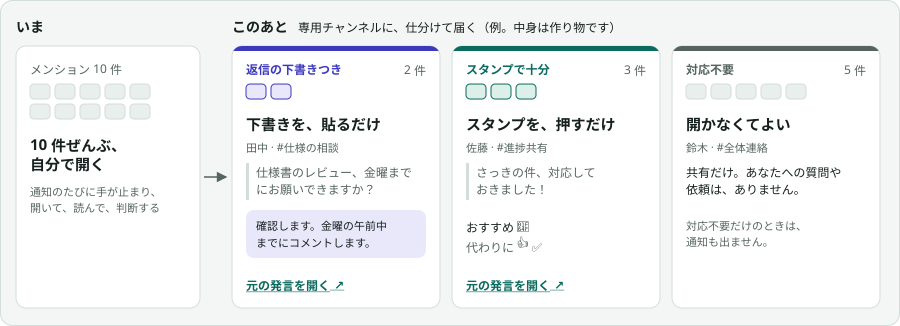
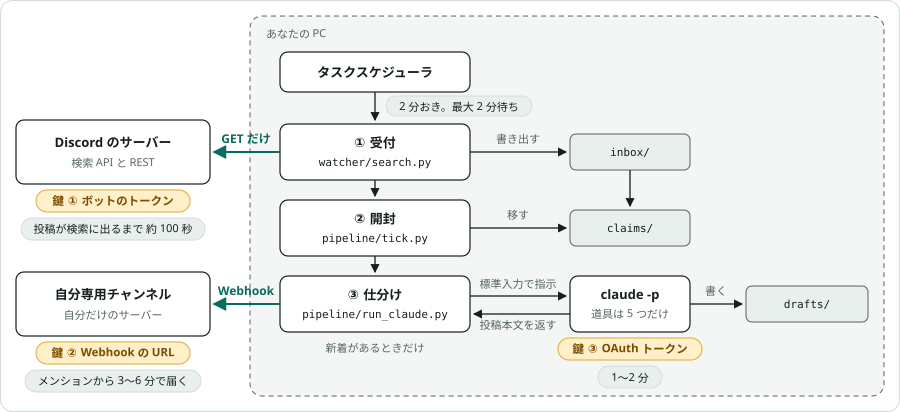

# discord-mention-triage

Discord の自分宛てメンションを、検索 API で 2 分おきに拾い、`claude -p` で「返信の下書きつき／スタンプで十分／対応不要」に仕分けて、自分専用のチャンネルへ Webhook で届けます。
セットアップは、リポジトリ同梱の Claude Code のスキルが進めます。

- メンションされてから、結果が届くまで **3〜6 分**
- Discord には何も書き込みません（読むだけ）
- Windows で動きます。Python の標準ライブラリだけで動くので、`pip install` は要りません

## 何が変わるか

メンションは、開くまで、返信が要るかどうか分かりません。10 件来れば、返信が要るのが 2 件だけでも、10 件ぜんぶを自分で開くことになります。
このあとは、仕分けた結果が専用チャンネルに届き、見るのは結果だけです。



「元の発言を開く」は、Discord のその発言へ飛ぶリンクです。

> [!IMPORTANT]
> **AI は、Discord に何も送りません。** 返信を書き込むのも、スタンプを押すのも、あなた自身です。AI がするのは、読んで、仕分けて、下書きを用意する所までです。

## しくみ



黄色は、そこで要る鍵です。灰色は、かかる時間です。緑の 2 本が、PC の外へ出る線です（Discord へは GET だけ、書き込むのは専用チャンネルへの Webhook だけ）。

<details><summary>時間の根拠</summary>

| かかる所 | 時間 | 根拠 |
|---|---|---|
| 投稿が、ボットの引く検索 API の結果に出る | 約 100 秒 | ボットのトークンで実測。89・100・117 秒（2026-10-10、3 件） |
| 次の起動を待つ | 0〜2 分 | 2 分おき。1 分より短くしない（検索は、引きすぎるとすぐ 429） |
| 仕分け（`claude -p`） | 1〜2 分 | 長さによる。短い 2 件の実測は 25〜29 秒 |

</details>

部品ごとの動き、失敗したときの動き、ファイルの置き場は、[しくみ](docs/how-it-works.md) にあります。

## 必要なもの

- Windows の PC（自動起動に、タスクスケジューラを使います）
- Python 3.10 以上と Git
- Claude Code（コマンドの `claude`）と、Claude のサブスクリプション
- ボットを招待してもらえる Discord のサーバー（自分が管理者でなければ、管理者に頼みます）
- あれば Claude in Chrome（Discord の画面操作を、Claude が進めます）

## 鍵の扱い

> [!WARNING]
> - **鍵は、`.env` にだけ置く。** ボットのトークン、Webhook の URL、Claude の OAuth トークンの 3 つ（どこで要るかは、上の図の黄色い札）。チャットにも、リポジトリにも、メモにも貼りません。
> - **鍵が画面に出る操作は、自分でする。** スキルは鍵を聞かず、`.env` を読まず、鍵が出ている間は画面を見ません。
> - **ID は、秘密ではない。** ユーザー ID、チャンネル ID、アプリ ID は、チャットに貼って構いません。

## セットアップ

4 ステップです。自分の手を動かすのは、主に 3 です。

### 1. スキルを起動する

```powershell
git clone https://github.com/umezy/discord-mention-triage.git; cd discord-mention-triage
claude
```

Claude Code が起動したら、`/triage-setup` と打ちます（「セットアップして」でも同じです）。ここから先は、Claude が、次の 1 手を言います。

### 2. Discord 側を用意する

ボットと、結果を届ける専用チャンネルを作ります。Claude in Chrome がつながっていれば、画面は Claude が操作します。

**Claude がすること**

- Developer Portal で、ボットを作る
- 自分だけのサーバーに、専用チャンネルと Webhook を作る
- 招待 URL と、管理者への依頼文を用意する

**あなたがすること**

- 作成の確認に答える
- 依頼文を、サーバーの管理者に送る
- 自分のユーザー ID を、チャットに貼る

**管理者がすること**

- ボットを招待する
- あなたと同じ範囲が見えるロールを付ける

ここで作るのは、ボットと Webhook そのものです。鍵は、まだ取り出しません（3 で、自分で取り出します）。管理者の返事は、待たずに 3 へ進めます。

自分の手で作るときの押す順と、管理者への依頼文は、[Discord 側と鍵を用意する](docs/get-the-keys.md) にあります。

### 3. 鍵を 3 つ、`.env` に書く

2 で作ったボットと Webhook から、鍵を取り出して、`.env` に書きます（鍵 ③ だけは、ここで新しく作ります）。
Claude が、メモ帳で 2 つの `.env` を開き、鍵が出る画面まで案内します。あなたは、ボタンを押して、貼るだけです。Claude は鍵を見ないので、ここだけは自分の手で進めます。

**鍵 ① ボットのトークン**

- 手に入れる所: [Developer Portal](https://discord.com/developers/applications) → 自分のアプリ → **Bot** → **トークンをリセット**（表示は 1 回だけ）
- 書く所: `~/.discord-mention-triage/.env` の `DISCORD_BOT_TOKEN=`

**鍵 ② Webhook の URL**

- 手に入れる所: 専用チャンネルの歯車 → **連携サービス** → **ウェブフック** → **ウェブフックURLをコピー**
- 書く所: `~/.discord-mention-triage/<名前>/.env` の `DIGEST_WEBHOOK=`

**鍵 ③ Claude の OAuth トークン**

- 手に入れる所: 自分のターミナルで `claude setup-token` → ブラウザで、仕分けに使うアカウントを承認 → 表示された文字列（1 年有効）
- 書く所: `~/.discord-mention-triage/<名前>/.env` の `CLAUDE_CODE_OAUTH_TOKEN=`

`=` の直後に、空白も引用符も入れずに貼って保存し、Claude に伝えます。

> [!WARNING]
> **鍵 ③ のアカウントは、本文を学習に使わせない設定にしておく。**
> メンションの本文は、鍵 ③ を作ったアカウントで、Claude に送られます。個人の契約（Free / Pro / Max）では、設定が ON だと、Claude Code から送った分も、Anthropic のモデルの学習に使われます。
> [claude.ai の 設定 → プライバシー](https://claude.ai/settings/data-privacy-controls) で、**Help improve our AI models** を OFF にします。会社の契約（Team / Enterprise）では、使われません（[公式の説明](https://code.claude.com/docs/en/data-usage)）。

> [!CAUTION]
> **ここで、してはいけないこと**
> - 鍵を、チャットに貼る
> - `claude setup-token` を、Claude に実行させる（出力が、会話に残ります）
> - すでに動いているボットで **トークンをリセット** を押す（前のトークンが失効します）

### 4. 確かめて、自動起動を登録する

**Claude がすること**

- 設定と鍵、Discord を読めるかを確かめる
- 仕分けを 1 回動かして、届くかを確かめる
- タスクスケジューラに登録する（2 分おき）

**あなたがすること**

- 同僚に、自分宛てのメンションを 1 通頼む
- リアクションも返信もせずに 2〜3 分待ち、専用チャンネルに届いたかを見る
- 登録の確認に答える

ボットが招待されるまでは、Discord を読めません。招待されてから、この手順を通します。

<details><summary>よくある [NG]（Claude が、直し方を言います）</summary>

| 出力 | 原因と、すること |
|---|---|
| `ボットのトークン: 無い` | `.env` に書けていない。行の形（`名前=値`）と、保存を確かめる |
| `http_401…` | トークンが違う。鍵 ① をやり直す |
| `http_403…` | まだ招待されていない、または「メッセージ履歴を読む」が無い。管理者の返事を待つ |
| `Webhook: 無い` | 鍵 ② を書けていない |
| `claude_auth` | 鍵 ③ が無い、または違う。やり直す |

</details>

Claude Code を使わずに、コマンドで進めることもできます（[コマンドで進める](docs/setup.md)）。

## 困ったとき

リポジトリを Claude Code で開いて、起きたことを、そのまま伝えてください。スキルが、状態と設定を調べて、原因と、することを言います。

```text
> 状態を見て
> 届かなくなった
> 自動起動を外して
```

<details><summary>何を読み、どこへ送るか</summary>

- 読むのは、自分宛てのメンション（名指し、ping つきの返信、自分が持つロール宛て）と、その前後の会話（前 15 件、後 10 件）。ボットに見えるチャンネルだけです。
- 本文は、`claude -p`（OAuth トークンを作ったアカウントの契約）に送られます。
- 仕分けの結果は、専用チャンネルに Webhook で届きます。メンションの引用を含みます。
- 設定、鍵、本文は `~/.discord-mention-triage/` に置かれます。リポジトリの中には置きません。ログには、件数と理由しか書きません。
- 仕分けのセッション記録（本文を含みます）は、`~/.claude/projects/` に残ります。Claude Code の既定で、30 日たつと消えます。

</details>

<details><summary>費用</summary>

Discord のボットと Webhook は、無料です。仕分けは、Claude のサブスクリプションの利用枠を使います。新着が無い回は、Claude を起動しません。

</details>

<details><summary>見られるチャンネルが変わった（異動など）</summary>

ボットは、あなたとは別のメンバーです。あなたのロールが外れても、ボットのロールは、自動では外れません。管理者に、ボットのロールも合わせて直してもらいます。

</details>

<details><summary>やめたい</summary>

1. Claude Code に「自動起動を外して」と頼む。タスクスケジューラの登録が外れます。設定と鍵は、PC に残ります。
2. 管理者に、ボットをサーバーから外してもらう。
3. 鍵を無効にするなら、Webhook を削除し、ボットのトークンをリセットする（または、アプリごと消す）。

</details>

「⚠」で始まる通知の意味、結果が届かないときに見る所、自分で調べるときの見方は、[困ったとき](docs/troubleshooting.md) にあります。

## もっと詳しく

| 知りたいこと | ページ |
|---|---|
| しくみ（部品ごとの動き、失敗したときの動き、ファイルの置き場） | [docs/how-it-works.md](docs/how-it-works.md) |
| 安全面（読むだけ、本文は命令ではない、PR の自動レビューはしない。何で守っているか） | [docs/security.md](docs/security.md) |
| Discord 側と鍵を、自分の手で用意する | [docs/get-the-keys.md](docs/get-the-keys.md) |
| コマンドで進める、コマンドと設定 | [docs/setup.md](docs/setup.md) |
| 届く通知と、自分で調べるときの見方 | [docs/troubleshooting.md](docs/troubleshooting.md) |
| そのほか（別の PC へ移す、未決事項、決定の記録） | [docs の目次](docs/README.md) |

## ライセンス

[MIT](LICENSE)
