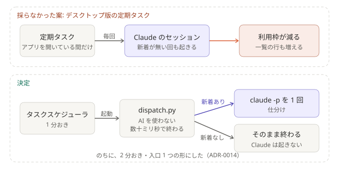

# ADR-0003: 定期実行は Claude の外に置き、新着があるときだけ `claude -p` を起こす

## 背景と課題

- 要望は「定期タスク自体は Claude 以外で持ち、Claude のセッションは必要なときだけ動かす」こと。
- デスクトップ版の定期タスクは、新着が無い回も毎回セッションを起こす。費用（利用枠）が減り、一覧の行も増える。さらに、
  アプリを開いていて PC が起きている間しか動かない（公式ドキュメント）。

## 決定

- Windows のタスクスケジューラが 1 分おきに `dispatch.py`（AI 不使用）を起動する。受付の生存確認、滞留の掃除、claim（`mv` をロックに使う）、
  同時実行数の制限（既定 2）、異常の通知までを、ここで行う。
- **新着があるときだけ**、`run_claude.py` が `claude -p` を 1 回起こす。
- 受付は、ログオン時に起動する。受付が落ちたら、1 分後に自動で再起動を試みる（最大 3 回）。
- タスクは `conhost --headless` 経由で起動する。`powershell -WindowStyle Hidden` だけでは、1 分ごとに黒い画面が一瞬出るため。

### 結果

- 新着が無い回は、数十ミリ秒で終わり、Claude を起こさない。
- PC が起きていて、ログオンしている間だけ動く。スリープや電源オフの間は止まり、復帰時の追い込みで拾う。
- 登録のしかたは `scripts/` のスクリプトにある（`-Uninstall` で解除）。

## 採らなかった案

- デスクトップ版の定期タスク: アプリが必須で、空振りでもセッションができる。
- CLI の `/loop`: セッションが開いている間しか動かない。
- クラウドの routines: 最小間隔が 1 時間で、ローカルのファイルを読めない。

## 補足

- 一部を変えた ADR:
  - [ADR-0014](0014-poll-search-api-single-entry.md): タスクの本数・間隔・Claude の起こし方。「Claude の外で定期実行し、新着があるときだけ起こす」は、そのまま
- 関連: [しくみ](../how-it-works.md)、[setup.md](../setup.md)
