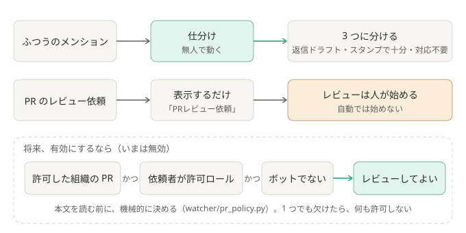

# ADR-0004: 仕分けは無人化し、PR の自動レビューは無効にする

## 背景と課題

「PR レビューの依頼が来たら、手元のソースを読んでチェックまで進める」という構想もあった。
PR レビューは最大 1 時間かかり、git / gh の操作や push が絡む。**本文（誰でも書ける）を契機に、権限の大きい操作を無人で動かす**ことになるため、
仕分けより危険が大きい。

## 決定

- 先に無人化するのは、**仕分け**（返信ドラフト／スタンプで十分／対応不要）だけ。
- PR の依頼は、「PRレビュー依頼」と表示するだけにする（`pr_auto_review: false`）。レビューは、人が手で始める。
- 将来、自動レビューを有効にする場合の許可条件は、**何も許可しない（fail-closed）** を既定にする。
  許可した組織（`allowed_orgs`）の PR で、かつ、依頼者が許可ロール（`requester_role_ids`）を持ち、ボットでないときだけ。
  条件は、**本文を読む前に決まる機械的な判定**にする（`watcher/pr_policy.py`）。

### 結果

- PR のレビューは人が起動する。仕分けの結果に、PR の URL が出る。
- 有効にするには、実行記録の `denials` を見ながら、許可ルールを育てる。レビュー用の worktree の作成・push・追従 PR を、
  無人でどこまで許すかを、そのとき決める。

## 採らなかった案

- 最初から PR レビューも無人化する: 許可ルールが未成熟で、実行記録の `denials`（拒否された操作）も、まだ見ていない。

## 補足

- 関連: [security.md](../security.md)、[未決事項](../open-questions.md#pr-の無人レビューを有効にする)
