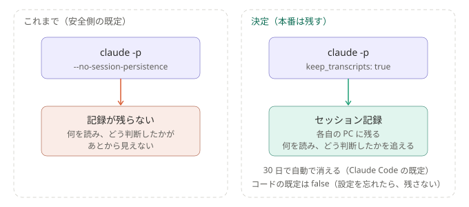

# ADR-0008: セッション記録は本番も残す

## 背景と課題

- 当初の既定は、`--no-session-persistence`（本文を含むセッション記録をディスクに残さない）だった。これは、設計時に安全側に倒した既定で、
  使う人と相談して決めたものではない。
- 残さないと、**Claude が何を読み、どう判断したかが、あとから見えない**。例えば「手元のリポジトリに今日の分が見当たらなかった」と書かれても、
  探し方が分からない。
- 記録が残るのは、**その人の PC**で、**その人のボットが見られる内容だけ**。

## 決定

- 本番も `keep_transcripts: true` にする（設定の雛形 `config.example.json` も `true`）。
- コードの既定は `false` のままにする。設定を忘れても、本文が残らない側に倒れるように。
- 保持は、Claude Code の既定（**30 日で自動削除**、`cleanupPeriodDays`）に任せる。不要になれば `claude purge` で消せる。

### 結果

- 本文と、手元のリポジトリから読んだ内容が、各自の PC に 30 日残る。1 回あたり約 250KB（短いテストでの実測）。
- `drafts/`・`processed/`・`failed/`・`runs/` の掃除は、まだ無い（[未決事項](../open-questions.md#溜まったファイルの掃除)）。
- 記録は、`~/.claude/projects/<作業フォルダ名>/<セッションID>.jsonl` に残り、実行記録に `session_id` が入る。

## 採らなかった案

- 残さない（`false`）: 理由は上のとおり。判断の過程が追えない。
- 検証の間だけ残す: 運用が始まったあとの不具合の調査で、記録が無い。

## 補足

- 関連: [しくみ](../how-it-works.md)、[未決事項](../open-questions.md#溜まったファイルの掃除)
