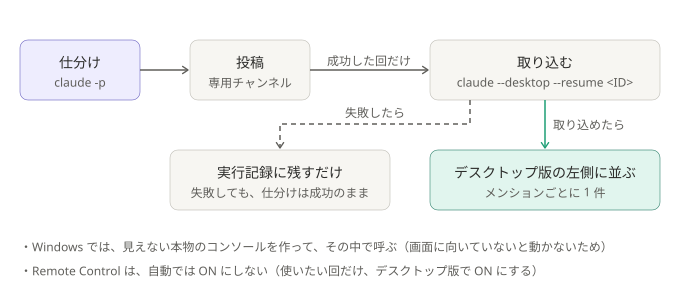

# ADR-0009: 仕分けのたびに、セッションをデスクトップ版へ取り込む

## 背景と課題

- `claude -p` のセッションは、そのままでは、デスクトップ版の左側の一覧に出ない（CLI の選択画面から外されることは公式ドキュメントにあり、
  デスクトップ版の一覧に出ないことは実測で確認した）。判断の過程を、画面で見られるようにしたい。
- `claude --desktop --resume <ID>` で、記録済みのセッションを取り込める（公式）。取り込むと、そのセッションが左側に並ぶ。
- ただし、`--desktop` は、**出力が画面（コンソール）に向いていないと動かない**（リダイレクトされていると、すぐ終了コード 1）。
  無人の実行は、入出力が NUL やログファイルなので、そのままでは失敗する。`conhost --headless` は、入出力が NUL やファイルだと、
  **中身を起動せずに成功（0）を返し**、終了コードも返さない（実測）。

## 決定

- `desktop_import: true`（`keep_transcripts: true` が前提）なら、投稿のあと、**成功した回だけ**取り込む。
- セッションの名前は `triage <時刻> <実行ID>`（`--name`）。**メンション本文は入れない。**
- Windows では、**非表示の本物のコンソールを新しく作って**、その中で呼ぶ（`CREATE_NEW_CONSOLE` ＋ `SW_HIDE`、入出力は渡さない）。
- 取り込みの失敗は、実行記録の `desktop_import` に残すだけで、**仕分けの成否には影響させない**（見やすさのための機能なので）。
- **Remote Control は、自動では ON にしない。** デスクトップ版の「新しいセッションを Remote Control に接続する」設定は ON にしたが、
  効くのは、デスクトップ版で始めたセッションだけで、取り込んだセッションには効かなかった（`claude -p --remote-control` も効果なし）。
  使いたい回だけ、ツールバーのスイッチ（または `/remote-control`）で ON にする。

### 結果

- メンションごとに、左側に 1 件ずつ並ぶ。数が増えるので、デスクトップ版の「非アクティブなセッションをアーカイブ」の設定を勧める。
- 取り込み時に、デスクトップ版が前面に出るかは、未確認。邪魔なら、`desktop_import` を `false` にする。
- 取り込んだセッションは、デスクトップ版で続きを話せる。**中身には誰でも書ける本文が入る**ので、続きは確認の質問だけにする。
  取り込み後の許可の初期値は未確認（[security.md](../security.md)）。

## 採らなかった案

- デスクトップ版の定期タスク: 左側には並ぶが、アプリが必須で、空振りでもセッションができる（[ADR-0003](0003-scheduler-outside-claude.md) と矛盾）。
- `claude --bg`（バックグラウンドセッション）: 端末の一覧には出るが、デスクトップ版に出るとは書かれていない。`-p` と併用できず、費用や拒否の数を取る
  今の仕組みを作り直すことになる。
- 擬似的に対話型で動かす: 無人化が複雑で、壊れやすい。
- 手動で取り込むだけにする: 左側に常に並ぶ、という要望を満たさない。

## 補足

- 一部を変えた ADR:
  - [ADR-0015](0015-one-command-one-folder.md): 既定は、取り込まない。取り込みの機能は、そのまま
- その後変わった所: セッションの名前に、本文の頭も入れるようにした。いまの形と、通す文字の決め方は、[しくみ](../how-it-works.md) と [security.md](../security.md#プロンプトインジェクション)
- 関連: [しくみ](../how-it-works.md)、[security.md](../security.md)、[ADR-0008](0008-keep-session-transcripts.md)
