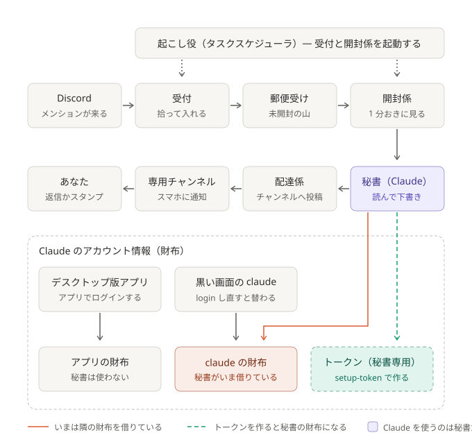

# ADR-0012: 無人実行は専用の長期トークンで動かし、`claude` のログインに頼らない

上半分がメンションの流れ、下半分が Claude のアカウント情報（財布）。Claude を使うのは秘書だけで、いまは隣の「`claude` の財布」を借りている。トークンを作ると、秘書専用の財布になる。デスクトップ版アプリの財布は、秘書にはつながっていない。

## 背景と課題

- 2026-10-04 15:49 から丸 1 日、仕分けが止まった。原因は、PC に保存された `claude` のログインだった。保存されていたのは、契約を変える前の状態のログインで、
  API に `403 oauth_not_allowed_for_organization` で拒否された。ログインし直すと、すぐ動いた。変えたのは、そこだけ。
  なぜその日に使えなくなったかは、分かっていない。
- 無人実行は、`claude` の対話用のログイン（`~/.claude/.credentials.json`）を、そのまま使っていた。setup.md も
  「ログイン済みなら、長期トークンは作らなくてよい」と案内していた。
- このログインは、**PC に 1 つしか無い。** Claude のアカウントを 2 つ使い分けていると、端末で `claude auth login` をし直すたびに、無人実行も一緒に切り替わる。
  デスクトップ版アプリのログインは、別の場所に保存されていて、無人実行には影響しない（10-05 に、デスクトップ版と端末側で、ログインしている契約が食い違っているのを実測）。
- **端末のログインには寿命がある。** 毎回の通信に使う部分は約 8 時間で、使うたびに自動で延びる。ただし、延ばす権利そのものにも期限があり、
  10-05 のログインでは 2026-11-02 までだった（約 4 週間）。10-09 の自動延長では、この期限は動かなかった。使い続ければ延びるのかは未確認。
  公式も、ログインの期限が近づくと「`/login` で更新せよ」と警告する、としている。
- 公式の優先順位では、環境変数 `CLAUDE_CODE_OAUTH_TOKEN`（`claude setup-token` で作る、1 年有効のトークン）が、`/login` のログインより先に使われる
  （[公式](https://code.claude.com/docs/en/authentication)）。期間は 1 年で固定（オプションは無い）。コードは、`<名前>/.env` のこのトークンを `claude` に渡す作りに、すでになっている。
- 実測（2026-10-05）: トークンが無い状態で、空の設定フォルダを指して動かすと、"Not logged in" で拒否された（費用 0）。
  いま動いているのは、`claude` のログインがあるから、というだけ。
- 実測（2026-10-09）: トークンを `<名前>/.env` に置くと、同じ空の設定フォルダでも動いた（`check_claude.py --isolated` が `OK auth=token`）。
  `claude` のログインに頼らずに動くことを、実機で確認した。

## 決定

- **無人実行は、専用の長期トークンで動かす。** `claude setup-token` で作り、`<名前>/.env` に `CLAUDE_CODE_OAUTH_TOKEN` として置く。これを標準の手順にする。
- トークンは、**仕分けに使うと決めたアカウント**で作る。
- トークンが無いときは、これまでどおり `claude` のログインで動かす（止めはしない）。ただし、実行記録に `auth: cli_login` を残し、
  モデルが動く前のエラーの通知に、トークンの設定を促す一文を足す。
- 確認用に `pipeline/check_claude.py` を足す。`--isolated` は、空の設定フォルダ（`CLAUDE_CONFIG_DIR`）を指して動かし、
  `claude` のログインに頼らずに動くかを確かめる。本番の実行に渡す環境変数は、変えない。

### 結果

- 得るもの: `claude` でどのアカウントにログインしていても、ログアウトしていても、無人実行は同じアカウントで動き続ける。
  端末のログインの期限（約 4 週間と見られる）にも左右されない。
- 引き受けるもの: トークンは 1 年で切れる（切れると、「Claude にログインできていない」の通知が出て、届いた分は溜めて待つ。作り直して `.env` を書き換える）。
  モデルへの要求にしか使えない（この仕組みには足りる）。`<名前>/.env` に秘密が 1 つ増える。
- 防げないもの: トークンを作ったアカウントそのものの契約が、切れた・使えなくなった場合。そのときは [ADR-0011](0011-wait-when-claude-never-ran.md) のとおり、溜めて待ち、通知する。
- 未確認: 契約の変更（Pro → Max など）で、発行済みのトークンが無効になるか。端末のログインの「延ばす権利」が、使い続けると延びるのか（11-02 前後に分かる）。

## 採らなかった案

- **端末のログインに従う（トークンを置かない）**: 2026-10-09 に、いったんこちらが望ましいとした（切り替えが 1 か所で済む）。採らなかった理由は 3 つ。
  (1) 延ばす権利の期限が約 4 週間と見られ、1 年のトークンより手がかかる。(2) 端末で別のアカウントにログインすると、無人実行も意識せずに切り替わり、
  どの契約でメッセージを処理したかが曖昧になる。(3) 10-04 のような、保存されたログインが古くなる事故を防げない。
- 仕分け専用の設定フォルダ（`CLAUDE_CONFIG_DIR`）に、別のログインを持つ（公式の「複数アカウント」のやり方）: ログインは自動で更新される。
  ただし、セッション記録もそのフォルダに分かれるので、デスクトップ版への取り込み（[ADR-0009](0009-import-sessions-into-desktop.md)）や
  `claude --resume` と噛み合わない。期限の問題も同じ。
- 拒否されたら、もう一方の資格情報で試す（トークン → `claude` のログイン）: どちらかが生きていれば動く。ただし、どの契約で処理したかが、
  その時々で変わる。「どの契約で処理するかを、意識して選ぶ」に反する。
- トークンが無ければ動かさない: 設定を忘れると止まる。いまは、通知で促すにとどめる。

## 補足

- 関連: [setup.md「Claude の合鍵」](../setup.md#claude-の合鍵)、[ADR-0011](0011-wait-when-claude-never-ran.md)
- 理由を 2026-10-09 に追記した。
