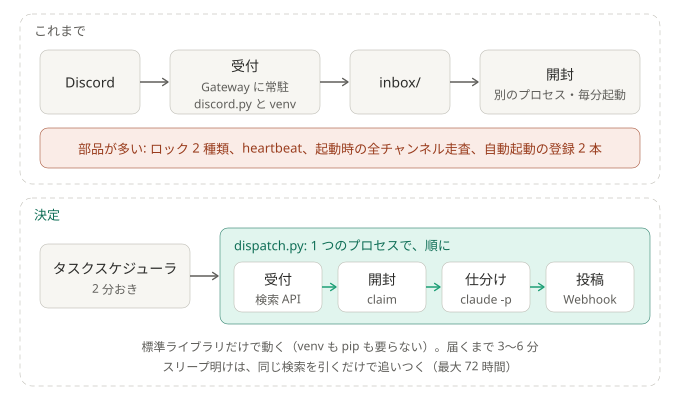

# ADR-0014: 取得は検索 API を数分おきに引く形にし、常駐をやめて、入口を 1 つにする

## 背景と課題

- 「読むだけ」「新着があるときだけ Claude」「権限は最小限」という方針は、そのままでよい。無駄は、部品の数にあった（2026-10-05 にコードと実行記録で確認）。
  - 受付は常駐していて、`inbox/` に書いた瞬間を知っている。それでも、別のプロセスが毎分起動して、見に行っていた。
  - この分離のためだけの部品が多かった: 2 種類のロックと 20 秒おきの更新、`heartbeat.json`、`skips.log` の受け渡し、切り離した起動、タスクの登録 2 本。
  - それまでの受付は、Gateway に常駐して受け取っていた。選んだ理由は即時性だった。ただし、60 秒寝かせてから毎分の開封を待つので、届くのは 1〜2 分後。即時性は使っていなかった。
  - 起動のたびに、約 450 チャンネルを走査して追い込んでいた（ログでは 27〜67 秒）。
- 人に配るときの障害は、`discord.py` と venv、自動起動の登録 2 本だった。
- Discord には、ボット向けのサーバー内検索がある（`GET /guilds/{id}/messages/search`。[公式](https://github.com/discord/discord-api-docs/blob/main/developers/resources/message.mdx)、2026-10-09 に確認）。
  メンション先のユーザー・ロールで絞れ、`min_id` で「これより新しいもの」を引ける。必要な権限は `READ_MESSAGE_HISTORY`。
  1 回に最大 25 件で、結果に `reactions` は入らない。索引がまだ無いときは、202 と待ち時間が返る。

## 決定

1. **受付は、検索 API を数分おきに引く。常駐しない。** Gateway と `discord.py` をやめる（`watcher/search.py`）。
   - 引くのは、直接のメンション（返信の ping を含む）、本人が持つロール宛て、設定していれば `@everyone`。宛先の判定（`watcher/detect.py`）は変えない。
   - **前回の続きから、30 分重ねて引く**（`search_overlap_minutes`）。検索の索引は、投稿より遅れ、順番も前後しうる。二重は、既出の ID で捨てる。
     PC が止まっていた間の分は、起きた最初の回が、同じ検索で拾う（最大 72 時間）。初回は「いま」から始め、過去の分は拾わない。
   - 投稿から 60 秒経っていないヒットは、何もせずに次の回へ回す（本人が先にスタンプや返信をするかもしれない）。`holding/` は要らない。
   - スタンプ済み・返信済みの判定と、前後の会話は、ヒットごとに REST の GET で取りに行く。
2. **入口は `pipeline/dispatch.py` の 1 つ。自動起動の登録は 1 本（2 分おき）。** 受付 → 掃除と claim → Claude → 投稿を、同じプロセスで順に行う。
   - 同時に動くのは 1 つだけ。OS のファイルロックで守る（持ち主が落ちれば、OS が外す）。Claude が動いている間に起動された回は、何もせずに終わる。
   - 消える部品: Gateway の常駐、`heartbeat.json`、起動時の追い込みと `cursors.json`、`holding/`、`skips.log`、ロックの古さの判定、`runs/*.lock` と 20 秒おきの更新、
     切り離した `run_claude.py` の起動、同時実行の上限（`max_parallel_runs`）、タスクの登録 2 本のうち 1 本、`discord.py` と venv。
   - 残す部品: `claims/` と試行回数の帳簿（途中で落ちた回の復旧と、毒入りの入力を 3 回で止めるため）、失敗した claim を 5 分後に戻す仕組み、
     `conhost --headless`（起動のたびに黒い画面を出さないため）。
3. **鉄則 1 を、次の形に書き換える。** 「`watcher/` は、Discord へ GET しか出さない。Discord と通信するのは `watcher/rest.py` の `get()` 1 つだけ」。
   これまでの「HTTP クライアントを入れない」は、「`rest.py` の 1 か所のほかに入れない」になる。テスト（`tests/test_readonly_guard.py`）も、
   `discord.py` の書き込みメソッドの検査から、「要求を組み立てる場所が 1 つで、`method="GET"` と決め打ち、本文なし」の検査に変わる。
   実際に出る要求がすべて GET であることは、偽の Discord を使う結合テスト（`tests/test_search_flow.py`）が確かめる。
4. **鍵の分け方は、プロセス単位から、モジュール単位になる。** 受付（`watcher/`）は、ボットのトークンを引数で受け取るだけ。
   投稿（`pipeline/notify.py`）は、Webhook だけ。Claude の子プロセスには、どちらも渡さない（`run_claude.child_env`）。ボットのトークンは、環境変数に置かない。
5. **読めていないことに、気づけるようにする。** Discord を読めない状態が 15 分続いたら（トークンの拒否は、すぐ）、Webhook で知らせる。同じ停止では、1 時間に 1 回。

### 置き換えるもの

- それまでの、Gateway に常駐する受付を置き換える。「自前で、読み取り専用で、公式ボットのトークンで読む」は変わらない。変わるのは、読み方（Gateway → 検索）。
- [ADR-0003](0003-scheduler-outside-claude.md) の「Claude の外で定期実行し、新着があるときだけ `claude -p` を起こす」は変えない。
  タスクの本数（2 → 1）、間隔（1 分 → 2 分）、Claude の起こし方（切り離す → その場で）を置き換える。
- 受付とパイプラインは、これまでどおり `inbox/` のファイルだけでつながる。

### 結果

- 得るもの: 自動起動は 1 本。標準ライブラリだけで動く（venv も pip も要らない）。スリープからの復帰は、同じ検索を引くだけ。
- 引き受けるもの:
  - **届くまでが、2 分弱から、3〜6 分になる**（実測では、常駐版は 1 分 40 秒前後。検索に出るまで約 100 秒かかり、そのあと、2 分おきの見回りを待つ）。
  - Claude が動いている間（数分）は、新着を拾わない。終わった次の回が、まとめて拾う。仕分けは、同時に 2 つは動かない。
  - 検索の索引に頼る。遅れが重ねる幅（30 分）を超えると、取りこぼす。
  - **あとから編集でメンションが足された投稿も、拾う**（これまでは、投稿された瞬間しか見ていなかった）。
  - サーバー内の名前（ニックネーム）を引くのは、メンションの投稿者だけ。前後の会話の投稿者は、アカウントの表示名になる。
- 気づけないもの: タスクスケジューラの登録そのものが、消えた・無効になった場合（これまでも、開封係のタスクが止まると気づけなかった）。
- 切り替え: `scripts/install-task.ps1` が、古い 2 本のタスクと、動いている常駐の受付を止めてから、新しい 1 本を登録する。
  最初の回は、常駐の受付が最後に生きていた時刻（`heartbeat.json`）から引くので、入れ替えの間の分を取りこぼさない。既出の ID（`state.json`）は引き継ぐ。

## 検証

2026-10-10 に、2 台目の PC で、本番のボットのトークンを使って確かめた。Discord へ出したのは GET だけ。
使ったのは、検証用のスクリプト（`experiments/search_api/verify_search.py`。役目を終えたので、この変更で消した。履歴に残る）と、新しい受付そのもの。

| 確かめたこと | 結果 |
|---|---|
| ボットのトークンで呼べる | OK。権限と Intent は、いまのままで足りる。サーバー 2 つで、検索の応答は 200。拒否なし |
| 直接のメンション、返信（ping ON） | OK。過去 3 日で、直接 15 件、返信 16 件。自分への返信 16 件は、すべて ping つきで、`mentions` の検索に出た |
| 自分が持つロール宛て | **未確認。** 期間内に、該当の投稿が無かった（本人のロールは 6 個） |
| スレッド、フォーラム | OK。31 件すべてが、フォーラムのスレッドの中。ふつうのチャンネルの投稿も、別に出た |
| 検索に出るまでの遅れ | 3 件を測って、89 秒・100 秒・117 秒。古い投稿が、新しい投稿よりあとに出た例は無い |
| 202（索引がまだ無い） | 0 回（約 670 回の検索で） |
| レート制限 | 続けて 9 回引くだけなら、当たらない。10 秒おきに 4 回ずつ引き続けると、3 回に 1 回が 429 になった（655 回中 229 回。待ちは 1 回あたり約 3 秒）。前後の会話の取得は、5 秒に 5 回まで |
| ボットが見えないチャンネルが出ない | ヒットのあった 3 チャンネルは、すべてボットが開けた。見えないチャンネルに投稿を作っての確認は、**していない** |
| 「スタンプ済み」判定のための取得 | OK。20 件で、本体・リアクションした人の一覧・前後の会話を、すべて取れた。1 件あたり約 2 秒 |
| 本文つきで返る | OK。49 件すべて |
| 受付が拾った分との突き合わせ | 2 台目で常駐の受付を動かした 33 分間（00:18〜00:51）で、両方にある 2、受付だけ 0、検索だけ 0。**数日分の突き合わせは、していない**（受付の記録が、1 台目にあるため） |
| 新しい受付（`watcher/search.py`） | 過去 72 時間を、別の置き場に向けて、2 回に分けて実際に引いた。合わせて 31 件を見つけ、スタンプ済み 10 件・返信済み 13 件を除いた 8 件を、書き出せた（長いほうの回で約 80 秒）。やり直し・失敗なし |

分かったこと:

- **成り立つ。** 取りこぼしは見つからなかった。スレッドも、フォーラムも出る。
- **検索に出るまで、約 100 秒かかる。** 60 秒の様子見より長いので、届くまでの時間は、これで決まる（約 100 秒 + 見回りを待つ最大 2 分 + 仕分け）。
  重ねる幅（30 分）は、十分に大きい。
- **引きすぎると、すぐ 429 になる。** 2 分おきに 4 回（サーバー 2 つ × 検索 2 種類）は、十分に下。起動の間隔を、1 分より短くしない。
  1 つのボットで何人ぶんも引くと、検索の回数が、ここで頭打ちになる。
- 受付は、残り回数が 0 と言われたら、戻るまで待ってから次へ進む作りにした（429 に当たる前に待つ）。
- まだ確かめていないこと: ロール宛て、見えないチャンネル、数日分の突き合わせ、タスクスケジューラからの実行。切り替えたあとに、確かめる。

## 採らなかった案

- **1 プロセス化（常駐の受付の中で、開封もする）**: 実サーバーでの検証が要らず、リスクは小さい。ただし、`discord.py` と venv、常駐、起動時の追い込み、`holding/` が残る。
  常駐が黙って止まったことを、外から見張る部品（いまの開封係）が無くなり、自分で自分を見張ることになる。検証が通らなければ、こちらにする。
- **検索は引くが、Claude は切り離して動かす（いまの形を残す）**: Claude が動いている間も、検索を引ける。そのかわり、ロックと、同時実行の数え方が残る。
  60 秒寝かせる作りで、即時性は使っていないので、採らない。
- **現状のまま**: 配るときの障害（依存と、登録 2 本）が残る。

## 補足

- その後変わった所: 投稿から 60 秒待つのを、やめた（検索に出るまでの約 100 秒が、様子見を兼ねる。[しくみ「なぜこの形か」](../how-it-works.md#なぜこの形か)）
- 関連: [ADR-0003](0003-scheduler-outside-claude.md)（一部を置き換える）、[しくみ](../how-it-works.md)
- 実サーバーでの検証は、2026-10-10 に行った（「検証」）。
