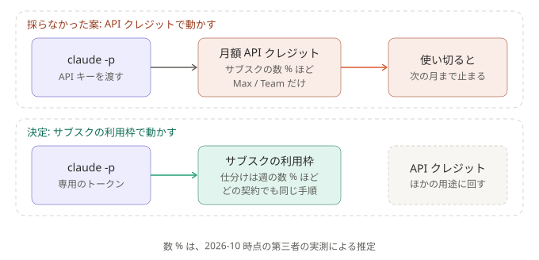

# ADR-0031: 無人実行はサブスクの利用枠で動かし、Max / Team の月額 API クレジットには切り替えない

## 背景と課題

- Max と Team の契約には、Claude Platform（API）で使える月額のクレジットが付く。Free と Pro には付かない。繰り越せず、使い切ると、買い足すか自動チャージを入れない限り、次の月まで API が止まる（[公式](https://support.claude.com/en/articles/17154008-monthly-api-credits-for-max-and-team-plans)）。
- 同じ記事によると、`claude -p` を、クレジットを受け取る Console 組織の API キーで動かすと、クレジットから引かれる。ログインや `CLAUDE_CODE_OAUTH_TOKEN` で動かすと、これまでどおりサブスクの利用枠から引かれる。
- `-p` では、`ANTHROPIC_API_KEY` があると、トークンより先に必ず使われる（[公式](https://code.claude.com/docs/en/authentication#authentication-precedence)）。いまは、これを子プロセスに渡していない（[ADR-0005](0005-minimal-claude-permissions.md)）。
- 量の見積もり（2026-10 時点。Anthropic は週の利用枠の大きさを公表していないので、第三者の実測による推定）:
  - 月額クレジットは、同じ契約のサブスクで使える量の数 % ほど。
  - `opus` / `xhigh` の仕分けは、1 日 20 回動いても、週の利用枠の数 % ほど。

## 決定

- 無人実行は、これまでどおり、専用の長期トークンでサブスクの利用枠を使う（[ADR-0012](0012-pin-unattended-runs-to-a-token.md)）。
- API キーは、子プロセスに渡さない。月額の API クレジットは、仕分けには使わない。

### 結果

- 得るもの: 仕組みが変わらない。Pro を含むどの契約でも、同じ手順で動く。「月の途中でクレジットが尽きて止まる」という止まり方が増えない。
- 引き受けるもの: 仕分けの分だけ、サブスクの利用枠が減る（上の見積もりでは数 %）。
  API の利点（入力が既定でモデルの学習に使われない、など）は得られない。個人の契約では、設定で学習を切る（[security.md](../security.md#データがどこを通るか)）。

## 採らなかった案

- 月額の API クレジットで動かす（`ANTHROPIC_API_KEY` を渡す）: クレジットはサブスクで使える量の数 % ほどで、サブスクの枠を節約する効果が小さい。
  使い切ると次の月まで止まる。Pro では使えないので、手順が契約で分かれる。クレジットは、サブスクでは動かせない用途（自前のアプリから API を直接呼ぶ、など）に回すほうが得。
- API キーがあればそちら、無ければトークンで動かす: 分岐が増え、どちらで処理したかが、置いた鍵しだいで変わる。

## 補足

- 関連: [ADR-0005](0005-minimal-claude-permissions.md)（渡さない環境変数）、[ADR-0012](0012-pin-unattended-runs-to-a-token.md)（長期トークン）
- クレジットの額や対象、サブスクの利用枠の大きさが変わったら、見直す。
