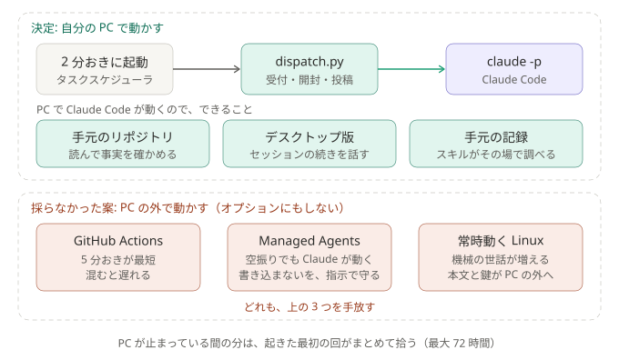

# ADR-0032: 仕分けは、Claude Code が入った自分の PC で動かす。PC の外で動かす形は、オプションとしても入れない

## 背景と課題

- PC の電源が切れている間も、仕分けを届けたい、という案が出た。
- 常駐するものは無い（[ADR-0014](0014-poll-search-api-single-entry.md)）。2 分おきに `dispatch.py` を起こすだけなので、PC の外に移すなら、要るのは定期実行の置き場と、状態ファイル（既出の ID と、続きの位置）だけ。
- PC が止まっていても、取りこぼしはしない。起きた最初の回が、止まっていた間の分（最大 72 時間）を拾う（[ADR-0014](0014-poll-search-api-single-entry.md)）。
  PC の外で動かして得られるのは、「PC から離れている間も、結果が届く」ことだけ。
- PC で Claude Code が動くことで、得ているものがある。PC の外で動かすと、どの置き場でも、これを手放す。
  - 手元のリポジトリを読んで、事実を確かめる（設定の `read_dirs`）。
  - 仕分けのセッションを、デスクトップ版で開いて、続きを話す（[ADR-0008](0008-keep-session-transcripts.md)、[ADR-0009](0009-import-sessions-into-desktop.md)）。
  - 実行記録と下書きが手元に残り、スキルが「状態を見て」に、その場で答える。

## 決定

- **仕分けは、これまでどおり、Claude Code が入った自分の PC で動かす。**
- **PC の外で動かす形は、オプションとしても入れない。** 選べるようにすると、置き場ごとのセットアップ、状態の受け渡し、文書、テストが増える。その手間に見合わない。

### 結果

- 得るもの: 仕組みと手順が 1 通りのまま。上の 3 つを保てる。「Discord に書き込まない」を、これまでどおりコードで守れる。
- 引き受けるもの: PC が止まっている間は、結果が届かない（起きたあとに、まとめて届く）。72 時間より長く止まると、その間の分は拾わない（[ADR-0018](0018-per-person-bot-no-shared-host.md) と同じ）。

## 採らなかった案

置き場の事実は、2026-10-12 に公式の文書で確かめた。

- **GitHub Actions の定期実行**: いまのコードがほぼそのまま動き、`claude setup-token` の長期トークンで、サブスクの利用枠も使える（[公式](https://code.claude.com/docs/en/github-actions)）。
  ただし、間隔は 5 分が最短で、混むと遅れたり、実行されなかったりする（[GitHub](https://docs.github.com/en/actions/reference/workflows-and-actions/events-that-trigger-workflows#schedule)）。
  公開リポジトリでは実行ログを誰でも見られ、非公開リポジトリでは、無料の実行時間に収めるために間隔を延ばすことになる。状態ファイルを、毎回次の回へ渡す仕組みも要る。
- **Claude Managed Agents の定期実行**: サーバー無しで動き、月額 API クレジットが使える。ただし、予定の時刻ごとに必ずセッションが立つので、空振りの回でも Claude が動く（[公式](https://platform.claude.com/docs/en/managed-agents/scheduled-deployments)）。
  ボットのトークンを AI が使える所に置くことになり、「Discord に書き込まない」が、コードではなく指示で守る形になる。作り直しになり、[ADR-0003](0003-scheduler-outside-claude.md)、[ADR-0005](0005-minimal-claude-permissions.md)、[ADR-0031](0031-stay-on-subscription-not-api-credits.md) を見直すことになる。
- **Claude Code のルーティン**: サブスクで動くが、間隔は 1 時間が最短（[公式](https://code.claude.com/docs/en/routines)）。空振りの回でも Claude が動く。
- **常時動く Linux の機械（クラウドの VM など）**: いまのコードがほぼそのまま動き、間隔も 2 分のまま。ただし、機械の世話が増え、本文と鍵の置き場が PC から移る。
- **どれかを、オプションとして足す**: 決定のとおり。

## 補足

- 関連: [ADR-0003](0003-scheduler-outside-claude.md)、[ADR-0014](0014-poll-search-api-single-entry.md)、[ADR-0018](0018-per-person-bot-no-shared-host.md)、[ADR-0031](0031-stay-on-subscription-not-api-credits.md)
- 「PC から離れている間も、結果が要る」ことがはっきりしたら、見直す。
