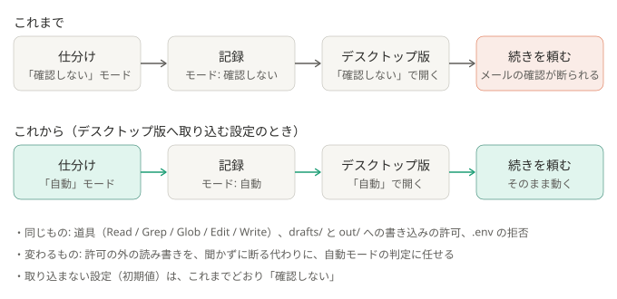

# ADR-0033: デスクトップ版へ取り込む設定のときは、仕分けを「自動」モードで動かす

## 背景と課題

- 取り込んだセッション（[ADR-0009](0009-import-sessions-into-desktop.md)）は、仕分けを動かしたときのモードで、デスクトップ版に開く。これまでは「確認しない」（`dontAsk`）だったので、
  続きで「メールが来ているか確認して」と頼むと、メールの道具が聞かれずに断られて止まった。続けるたびに、画面下でモードを切り替える必要があった。
- デスクトップ版は、取り込むとき、記録（`<セッションID>.jsonl`）に残ったモードを、そのまま使う。記録にモードが無いときだけ、デスクトップ版の既定になる。
  `claude --desktop --resume <ID>` には、ほかの指定（`--permission-mode` など）を一緒に渡せない（渡すとエラーで終わる）。
  取り込みの前後で、モードを選ぶ口は無い。どれも 2026-10-16 に、Claude Code 2.1.300 と、そのときのデスクトップ版で確かめた。

## 決定

- `desktop_import: true` のときだけ、`claude -p` を `--permission-mode auto` で動かす。記録に「自動」が残り、取り込んだセッションは「自動」で開く。
- 道具（Read / Grep / Glob / Edit / Write）、`drafts/` と `out/` への書き込みの許可、`.env` の拒否、`--permission-prompts none`、MCP とスキルを使わないことは、変えない。
- `desktop_import: false`（`init` が書く設定）は、これまでどおり `dontAsk`。

### 結果

- 得るもの: 取り込んだセッションで続きを頼むと、モードを切り替えずに、そのまま動く。
- 引き受けるもの:
  - 無人の仕分けで、許可の外の読み書き（`drafts/` と `out/` の外への書き込み、`claims/` と `read_dirs` の外の読み取り）が、聞かずに断られる代わりに、
    自動モードの判定で通ることがある。指示文が頼めば、外にも書けた。本文に紛れた「外に書け」には、3 回とも従わなかった（どちらも 2026-10-16、小さいモデルでの実測）。
    Bash もネットワークも無いので、外へ出す手段が無いことは変わらない。
  - 取り込んだセッションの続きでは、誰でも書ける本文が会話に入ったまま、メール・ブラウザ・Bash などが確認なしに動く。守りは、自動モードの判定だけになる。
  - 自動モードが使えないアカウントやモデルでの動きは、確かめていない。動かなければ、`desktop_import` を `false` にする。

## 採らなかった案

- 今のまま、続けるときだけ、画面下でモードを切り替える: 毎回の手間が残る。
- 取り込む前に、記録に残ったモードを書き換える: 記録が、実際の動きと食い違う。デスクトップ版の中の読み方に頼るので、更新で効かなくなりうる。
- 自動モードで動かしつつ、フック（PreToolUse）で、書き込み先を `drafts/` と `out/` に絞り直す: フックのコマンドは、PC ごとのシェルと Python の置き場に左右され、配りにくい。
  壊れると、仕分けが全部止まる。

## 補足

- この ADR が一部を変えた ADR:
  - [ADR-0005](0005-minimal-claude-permissions.md): 「許可していない操作は、聞かずに拒否する」は、取り込む設定のときは当たらない
  - [ADR-0009](0009-import-sessions-into-desktop.md): 「取り込み後の許可の初期値は未確認」は、記録に残ったモードになる、と確かめた
- 一部を変えた ADR:
  - [ADR-0042](0042-run-in-the-chosen-environment.md): 作業フォルダと、`--add-dir` で足したフォルダへの書き込みは、自動モードの判定に任せず、拒否のルールで止める
- 関連: [security.md](../security.md)、[しくみ](../how-it-works.md)
