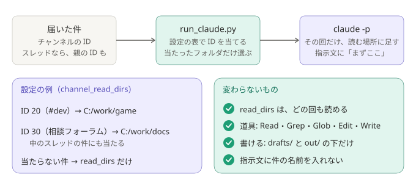

# ADR-0034: チャンネルごとに、仕分けの Claude が読むフォルダを足せるようにする

## 背景と課題

- 返信ドラフトの裏取りに使うフォルダは、チャンネルによって違う（あるプロジェクトのチャンネルなら、そのリポジトリ）。
- これまで読めるフォルダは `read_dirs` の 1 組だけで、どのチャンネルの件にも、同じ全部が読めた（[ADR-0005](0005-minimal-claude-permissions.md)）。
  チャンネルとフォルダの対応は、Claude が中身から推すしかなかった。
- 件には、チャンネルの ID がある。スレッド（フォーラムの投稿を含む）は ID が投稿ごとに変わるので、親の ID でも当てられないと、フォーラム全体に 1 つのフォルダを当てられない。

## 決定

- 設定に `watchers[].channel_read_dirs` を足す。形は `{"チャンネルの ID": ["フォルダ", ...]}`。ID は、スレッドの親（フォーラムやチャンネル）でもよい。
- 件に、スレッドの親の ID（`thread_parent_id`）を足す。
- `pipeline/run_claude.py` は、その回に届いた件のチャンネルの ID と親の ID を表で当て、当たったフォルダを `--add-dir` で足す。`read_dirs` は、これまでどおり、どの回も読める。
- 指示文に、当たった ID とフォルダを書き、「この ID の件は、まずこのフォルダで確かめる」と示す。件の名前（チャンネル名・スレッド名）は書かない。スレッド名は誰でも付けられるので、指示文に混ぜない。

### 結果

- 得るもの: チャンネルごとに、裏取りの場所を決められる。`read_dirs` を空にして、フォルダをチャンネルにだけ当てれば、関係の無いサーバーの件で、手元のリポジトリを読ませずに済む。
- 引き受けるもの:
  - 1 回の仕分けに、ほかの場所の件が混ざると、その回は、混ざった場所の分のフォルダも読める（件ごとに Claude を分けると、回数と費用が増えるので分けない）。
  - 当てたフォルダの中身は、ダイジェスト（本人専用チャンネル）や控えに引用されうる。鍵の入ったフォルダは当てない（`.env` の読み取りは、これまでどおり拒否する）。
  - 設定に ID を書く項目が 1 つ増える。
  - デスクトップ版へ取り込む設定（自動モード、[ADR-0033](0033-auto-mode-when-importing.md)）では、足したフォルダの外の読み取りも自動モードの判定に任される。そのときの効き目は、主に指示文の「まずここで確かめる」になる。
- 変わらないもの: 道具（`Read, Grep, Glob, Edit, Write`）、書ける場所（`drafts/` と `out/` の下）、`.env` の拒否、渡さない環境変数。

## 採らなかった案

- チャンネルに当てたフォルダで、`read_dirs` を置き換える: 「どの回も読める」と「この場所だけ」が混ざり、どの回に何が読めるかが分かりにくい。足すだけにした。
- チャンネル名で当てる: 名前は変えられ、同じ名前もありうる。`channel_blocklist` と同じく ID にした。
- 件ごとに Claude を分けて、読む場所を厳密に分ける: 回数と費用が増える。混ざった回に読めるのも、本人が設定で当てたフォルダに限られる。

## 補足

- 一部を変えた ADR: [ADR-0005](0005-minimal-claude-permissions.md)（読める場所に、届いた件の場所に当てたフォルダが加わる）
- 関連: [setup.md の「設定」](../setup.md#設定)、[security.md](../security.md)、[しくみ](../how-it-works.md)
