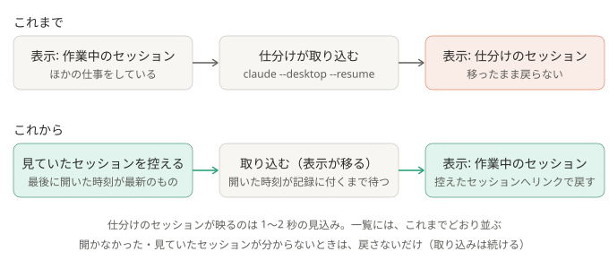

# ADR-0035: デスクトップ版へ取り込んだあと、見ていたセッションへ表示を戻す

## 背景と課題

- `claude --desktop --resume <ID>`（[ADR-0009](0009-import-sessions-into-desktop.md)）は「デスクトップ版で開く」命令で、デスクトップ版は、取り込んだセッションを必ず開き、
  ウィンドウを前に出す。取り込むだけで開かない指定は無い。そのため、ほかのセッションで作業していても、仕分けのたびに表示が仕分けのセッションへ切り替わっていた。
- デスクトップ版は、セッションごとの記録（`%APPDATA%\Claude\claude-code-sessions\<アカウント>\<組織>\local_<ID>.json`）に、最後に開いた時刻（`lastFocusedAt`）を残す。
  `claude://code/continue?session=local_<ID>` のリンクで、そのセッションを開ける。
- どれも 2026-10-15〜16 に、Claude Code 2.1.296 とデスクトップ版 2.37337 の中身と、実機で確かめた。

## 決定

- 取り込む前に、`lastFocusedAt` がいちばん新しいセッションを、見ていたセッションとして控える。
- 取り込んだセッションの記録に `lastFocusedAt` が付いたら（開いたら）、すぐ、控えたセッションを開くリンクを送って戻す。開く前に戻すと、取り込みの表示に上書きされる。
- 30 秒待っても開かない、見ていたセッションが分からない、Windows 以外、のときは戻さない。どの場合も、取り込みは続ける。結果は実行記録の `desktop_return` に残す。

### 結果

- 得るもの: 自動の取り込み（一覧に並ぶこと）を続けたまま、作業中のセッションから表示が離れたままにならない。
- 引き受けるもの:
  - 仕分けのセッションが 1〜2 秒映ってから戻る（見込み）。ウィンドウは、取り込みと戻しのたびに前に出る。その間に打った文字は、仕分けのセッションの入力欄に入りうる。
  - Chat や Cowork を見ていたときは、最後に開いた Code のセッションに戻る。切り替えて数秒以内だと、その前のセッションに戻る（開いた時刻は、数秒遅れて書かれる）。
  - デスクトップ版の中の形に頼る。更新で記録の形やリンクが変わると、戻らなくなる（取り込みは続く）。記録を探すのに、1 回 1 秒ほどかかる（約 3,000 件の頭を読む）。

## 採らなかった案

- PC をさわっていない間だけ取り込む: 戻ったとき、表示が仕分けのセッションになっている。一覧に並ぶのも遅れる。
- 自動の取り込みをやめ、見たい回だけ手で開く: 一覧に自動で並ばなくなる。
- デスクトップ版の記録を、こちらで直接書いて一覧に足す: 中の形に深く頼り、デスクトップ版が持っている一覧と食い違いうる。

## 補足

- この ADR が一部を変えた ADR:
  - [ADR-0009](0009-import-sessions-into-desktop.md): 「取り込み時に、デスクトップ版が前面に出るかは、未確認」は、前面に出て、表示もそのセッションへ移る、と分かった。取り込んだあと、見ていたセッションへ戻すようにした
- 関連: [しくみ](../how-it-works.md)、`pipeline/desktop_view.py`
