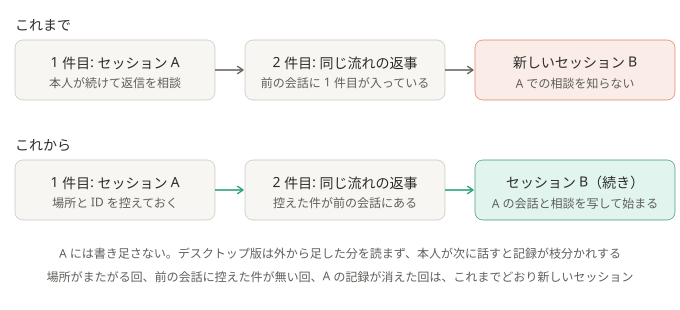

# ADR-0036: 同じ流れの続きのメンションは、前の仕分けの会話を写したセッションで仕分ける

## 背景と課題

- 仕分けのセッションは、起動 1 回ぶん（`dispatch.py` が claim した分）ごとに、`--resume` なしの `claude -p` で作る。単位は話題でもスレッドでもない。
- そのため、同じスレッドで同じ相手とのやり取りが続いても、別の回に届けば別のセッションになる。1 件目のセッションで、本人がデスクトップ版で続けて
  返信を相談しても、2 件目のセッションはその相談を知らない。本人が 2 つのセッションを行き来して、経緯を伝え直すことになる。
- 2 件目の前の会話（`context_before`）には、1 件目と本人の返信が入っている。続きかどうかは、機械的に分かる。
- 確かめたこと（2026-10-16、Claude Code 2.1.301、デスクトップ版 2.42304。小さいモデルで）:
  - `claude -p --resume <ID>` は、同じ ID のまま記録に書き足す。履歴に、いまより広い道具（Bash）の呼び出しがあっても、道具を絞って続けられる。
  - デスクトップ版は、取り込んだセッションの続きの位置を自分で覚えている。外から書き足した分を読まず、本人が次に話すと、書き足しの手前から
    枝分かれする。取り込み済みのセッションをもう一度 `claude --desktop --resume` すると、終了コード 1 で、表示も変わらない。
  - `--resume <ID> --fork-session` は、元の記録の最新の枝（デスクトップ版で話した分を含む）を写した、新しい ID のセッションを作る。
    取り込むと、デスクトップ版で、写した会話ごと見える。
  - 記録が無い ID へ `--resume` すると、終了コード 1（`No conversation found`）で、モデルは動かない。

## 決定

- 仕分けに成功したら、場所（チャンネル。スレッドならスレッド）ごとに、セッション ID と、仕分けたメッセージの ID を `<名前>/sessions.json` に控える。
  記録を残す設定（`keep_transcripts: true`）のときだけ。本文は書かない。
- 次の回で、claim した件がぜんぶ同じ場所にあり、控えたメッセージのどれかが、件の前の会話に入っていて、前のセッションの記録が残っていれば、
  `claude -p --resume <前の ID> --fork-session` で、前の会話を写した新しいセッションで仕分ける。名前の後ろに「（続き）」を付け、指示文に、続きであることを書く。
- 前のセッションには、そのまま書き足さない（上の、枝分かれのため）。
- 道具・許可・読める場所は、続けないときと同じ。続けた回が失敗したら、その場所の控えを消し、やり直しは新しいセッションにする。
- 判定のため、前後の会話の各発言に、メッセージ ID を足す（`pending-*.json` の形は、足すだけ）。設定の項目は、足さない。

### 結果

- 得るもの: 同じ流れの続きは、前の件の経緯と、本人がデスクトップ版で話した内容を知った状態で仕分けられる。本人は、いちばん新しい「（続き）」で話を続ければよい。
- 引き受けるもの:
  - デスクトップ版の一覧には、これまでどおり 1 回ごとに 1 件並ぶ。前のセッションは、そのまま残る（使わなくなったものは、本人がアーカイブする）。
  - 続けるたびに、前の会話をぜんぶ読み直すので、費用が上がる。会話が長くなれば、Claude Code が要約する（compact）。記録のディスクも、写すたびに増える（30 日で消える）。
  - 写すのは、仕分けを始めた時点の会話。本人がそのあと前のセッションで話した分は、写らない。
  - 仕分けの Claude が、本人がデスクトップ版で読ませたもの（ボットに見えない範囲を含みうる）も読む。投稿先は本人の専用チャンネルだけで、道具は増えない。
  - 同じ場所で、短い間に話題が変わると、前の話題の会話も引き継ぐ。前の会話（既定 15 件）から前の件が外れれば、新しいセッションに戻る。
  - 場所がまたがる回（ほかの場所の件と、同じ回に届いた）は、新しいセッションになる。
  - デスクトップ版と Claude Code の中の動きに頼る。変わったら、続けないか、枝分かれしうる。

## 採らなかった案

- 前のセッションに、そのまま書き足す（`--fork-session` なし）: デスクトップ版の一覧は増えないが、書き足した分がデスクトップ版に出ず、本人が次に話すと記録が枝分かれする（実測）。
- 新しいセッションのまま、前の回の控え（`drafts/`）を読ませる: 本人がデスクトップ版で話した内容が入らない。
- 本人がいまデスクトップ版で使っている間は、続けない: 写すだけなので、前のセッションを壊さない。条件を足す理由が無い。
- 続ける期限（何時間まで）や、会話の大きさの上限を設ける: 前の会話に前の件が入っているか、で十分に切れる。困ったら足す。
- 返信の参照（Discord の reply）で続きを見分ける: ping つきの返信でなく、名指しで続ける人もいる。前の会話のほうが広く拾える。

## 補足

- 一部を変えた ADR:
  - [ADR-0038](0038-add-to-the-same-session.md): 前のセッションを、いま動いている Claude Code が開いていなければ、写さずに、そのセッションに書き足すようにした。10/16 の枝分かれは、デスクトップ版の裏の処理が動いている間に書き足したためと分かった
  - [ADR-0044](0044-ask-if-same-topic.md): 続きと見なしても、24 時間より前に使われたセッションと、小さいモデルに聞いて前の件と別の話には、続けないようにした。同じスレッドの、別の人の別の話まで、前のセッションに入っていたため（上の「続ける期限を設ける」を採った）
- この ADR が一部を変えた ADR:
  - [ADR-0009](0009-import-sessions-into-desktop.md): 「メンションごとに、左側に 1 件ずつ並ぶ」は変わらないが、同じ流れの続きは、前のセッションの会話を写したセッションになる
- 関連: [しくみ](../how-it-works.md)、[security.md](../security.md#プロンプトインジェクション)、`pipeline/continuation.py`
