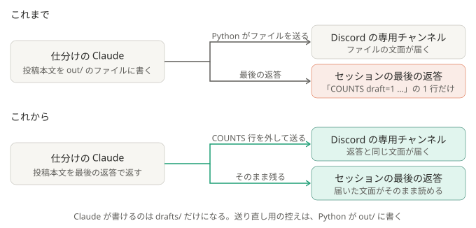

# ADR-0037: 投稿本文は、仕分けの Claude の最後の返答で受け取る

## 背景と課題

- 仕分けの Claude は、ドラフトの控え（`drafts/`）と投稿本文（`out/`）の 2 つのファイルを書き、最後の返答は `COUNTS …` の 1 行だけだった。Python は `out/` のファイルを確かめて投稿した。
- デスクトップ版へ取り込んだセッション（[ADR-0009](0009-import-sessions-into-desktop.md)）を開くと、最後に見えるのは `COUNTS …` の 1 行で、届いた文面は、折りたたまれたファイルの書き込みの中にしか無い。
  続きを相談するには、まず Discord の文面を見に行く必要があった。
- 同じ流れの続き（[ADR-0036](0036-continue-the-same-flow.md)）は、前の会話を写して始まるので、回を重ねるほど、どの回に何を送ったかが、書き込みの中に埋もれる。
- `claude -p --output-format json` の `result` は、最後の返答の全文で、それより前の発言は入らない。見出し・引用・コードブロック・`%%SPLIT%%` の行も、そのまま入る
  （2026-10-19、Claude Code 2.1.302、小さいモデルで確かめた）。

## 決定

- 投稿本文は、Claude の最後の返答で受け取る。最後の行に `COUNTS …` を付けさせ、Python はその行だけを外して、残りをそのまま投稿する（`pipeline/run_claude.py` の `digest_from_reply`）。
- 投稿本文のファイル（`out/<実行 ID>.digest.txt`）は、Python が返答から書く。投稿だけ失敗したときに、Claude を動かさずに送り直すための控えで、成功したら消す（これまでと同じ）。
- Claude が `out/` に書く許可（`Edit(…/out/**)`）は外す。書けるのは `drafts/` だけになる。
- ドラフトの控えは、これまでどおり、Claude が `drafts/` のファイルに書く。

### 結果

- 得るもの: セッションの最後の返答と、専用チャンネルに届く文面が、同じ 1 つのものになる（違うのは、先頭のメンションと、長いときの分割だけ）。
  デスクトップ版でセッションを開けば、Discord を見ずに続きを相談できる。「（続き）」のセッションでも、回ごとの返答として並ぶ。Claude の書き込み先が 1 つ減る。
- 引き受けるもの:
  - セッションの最後に、`COUNTS …` の行と、件の区切りの `%%SPLIT%%` が、そのまま見える。
  - 返答に前置きや後書きを付けると、それも投稿される。指示文で付けないよう頼むだけで、Python では削らない（どこまでが本文かを、機械的には決められない）。
  - 返答が `COUNTS` の行だけなら、投稿本文が無いとして失敗にする（これまでの、ファイルが無いときと同じく、やり直す）。
  - これまでに作ったセッションの中身は変わらない。

## 採らなかった案

- ファイルへの書き込みはそのままに、最後の返答で同じ文面を繰り返させる: 同じものを 2 回書くので、届いた文面とセッションの文面が食い違いうる。出力も 2 倍になる。
- 投稿のあと、セッションに文面を書き足す: 取り込む前なら書き足せるが、`claude -p --resume` でもう一度モデルを動かす（費用と、余計な 1 往復）か、
  記録のファイルを直接書く（Claude Code の中の形に頼る）ことになる。
- `%%SPLIT%%` を Markdown の区切り線（`---`）に変える: セッションでは見やすくなるが、本文の中の区切り線でも分かれてしまう。手で送る `post_digest.py` の形も変わる。

## 補足

- この ADR が一部を変えた ADR:
  - [ADR-0005](0005-minimal-claude-permissions.md): 書ける場所は `drafts/` だけになった。投稿は、Claude の最後の返答を Python が確かめてから行う
- 関連: [しくみ](../how-it-works.md)、[security.md](../security.md)
