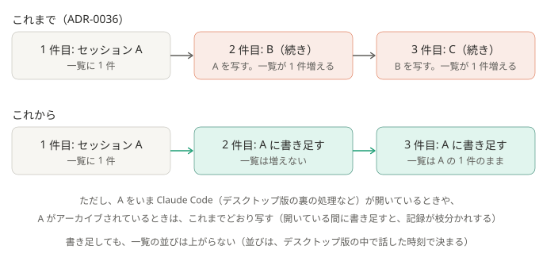

# ADR-0038: 同じ流れの続きは、前のセッションがどこでも開かれていなければ、そのセッションに書き足す

## 背景と課題

- [ADR-0036](0036-continue-the-same-flow.md) で、同じ流れの続きは、前の会話を写した新しいセッション（「（続き）」）で仕分けるようにした。
  会話は引き継げるが、デスクトップ版の一覧には、続きの件ごとに 1 件ずつ並ぶ。本人は、1 つのやり取りが、いくつもの項目に分かれて見える。
- ADR-0036 で書き足さなかったのは、取り込み済みのセッションに外から書き足すと、デスクトップ版がその分を読まず、本人が次に話すと記録が枝分かれしたため。
- 確かめたこと（2026-10-21、Claude Code 2.1.302、デスクトップ版 2.42304.2。小さいモデルで）:
  - デスクトップ版は、話しかけたセッションごとに、裏で Claude Code の処理を動かす。この処理が動いている間に外から書き足すと、
    次にデスクトップ版で話した分は、書き足しの手前から枝分かれする（10/16 の失敗は、これに当たる）。
  - 処理が動いていない間に外から書き足すと、デスクトップ版は記録を読み直し、次に話した分は、書き足した続きにつながる。
  - 裏の処理は、話しかけたあと、しばらく動いたままになる（話しかけて 30 分近く経っても動いていた）。取り込んだだけで話しかけていないセッションでは、動かない。
  - 動いている Claude Code は、`<設定フォルダ>/sessions/<プロセス ID>.json` に、開いているセッションの ID を書く。デスクトップ版の裏の処理も書く。
  - 外から書き足しても、デスクトップ版の一覧の並び（最後に話した時刻）は変わらない。取り込み済みのセッションを、もう一度
    `claude --desktop --resume` すると、こんどは成功して表示がそのセッションへ移るが、並びは変わらない。

## 決定

- 続きの回（ADR-0036 の条件に当たる回）は、次をすべて満たせば、`claude -p --resume <前の ID>`（`--fork-session` なし）で、前のセッションに書き足す。
  - 前のセッションを、いま動いている Claude Code が開いていない（`sessions/*.json` に、その ID と、動いているプロセスが無い）。
  - 取り込む設定（`desktop_import: true`）のときは、デスクトップ版の一覧に出ている（デスクトップ版の記録があり、アーカイブされていない）。
  - 前のセッションの名前が、`sessions.json` の控えにある（名前を控える前の形の控えは、写す）。
- どれかを満たさなければ、ADR-0036 のとおり、写した新しいセッションで仕分ける。次の続きは、その新しいセッションに書き足す。
- 書き足す回は、名前を付け直さず、デスクトップ版へ取り込み直さない（表示も移らない）。結果のあとの名前の 1 通は、書き足したセッションの名前で送る。
- `sessions.json` の控えに、セッションの名前を足す。道具・許可・読める場所・環境変数は変えない。設定の項目は足さない。

### 結果

- 得るもの: 同じ流れのやり取りは、たいてい 1 つのセッションに続けて並ぶ。書き足す回は、デスクトップ版の表示が切り替わらない。
- 引き受けるもの:
  - 書き足しても、そのセッションは一覧の上へ上がらない。どのセッションに届いたかは、名前の 1 通で知る。
  - 本人がデスクトップ版で話しかけてから、裏の処理が動いている間に続きが届くと、これまでどおり「（続き）」が 1 件増える。
  - 仕分けの最中に、本人がちょうどそのセッションを開いて話し始めると、その話は最新の仕分けの分を知らずに進む（記録が枝分かれする）。
  - Claude Code の `sessions/*.json` と、デスクトップ版の記録の形に頼る。前者が変わって読めなくなると、開かれていると気づかず
    書き足して、枝分かれしうる。後者が読めなければ、写す（ADR-0036 の動き）。
  - 1 つのセッションが長くなる。長くなれば、Claude Code が要約する（compact）。費用は、写すときと同じく、前の会話を読み直す分かかる。

## 採らなかった案

- 書き足したあとに取り込み直す: 並びは上がらず、表示が切り替わるだけ（実測）。
- 開かれている間は、閉じるまで仕分けを待つ: 裏の処理は 30 分近く動いたままのことがあり、そのあいだ結果が届かない。
- デスクトップ版の記録を書き換えて、並びを上げる・処理を閉じる: デスクトップ版の中の状態で、動いているデスクトップ版に上書きされうる。本人の作業も壊しうる。
- ADR-0036 のまま、古い「（続き）」を本人がアーカイブする: 本人の手間が残る。外からアーカイブする手段も無い。

## 補足

- 一部を変えた ADR:
  - [ADR-0039](0039-end-the-idle-desktop-process.md): 前のセッションを開いているのが、デスクトップ版の待機中の裏の処理で、画面に出ていなければ、その処理を終わらせてから書き足すようにした。裏の処理は、開いただけ・取り込んだだけでも始まり、何時間も動くと分かった（上の「30 分近く」「取り込んだだけでは動かない」は違っていた）
- この ADR が一部を変えた ADR:
  - [ADR-0036](0036-continue-the-same-flow.md): 「前のセッションには、そのまま書き足さない」を、前のセッションがどこでも開かれていないときは書き足す、に変えた
  - [ADR-0009](0009-import-sessions-into-desktop.md): 書き足した回は、取り込まない（取り込み済みのセッションに書き足す）
- 関連: [しくみ](../how-it-works.md)、[security.md](../security.md#プロンプトインジェクション)、`pipeline/continuation.py`、`pipeline/desktop_view.py`
