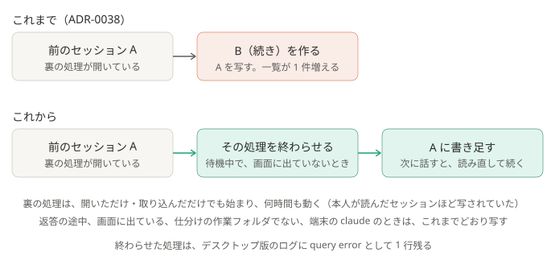

# ADR-0039: 前のセッションを、デスクトップ版の待機中の裏の処理が開いていたら、その処理を終わらせてから書き足す

## 背景と課題

- [ADR-0038](0038-add-to-the-same-session.md) で、同じ流れの続きは、前のセッションを、いま動いている Claude Code が開いていなければ書き足し、開いていれば写す（「（続き）」）ことにした。
- ADR-0038 は、裏の処理は「話しかけたあと、しばらく」動くと見ていた。デスクトップ版のログ（2026-10-21、Claude Code 2.1.304）で確かめると、違った。
  - 裏の処理は、セッションを**開いただけ・取り込んだだけでも**始まる（同時に動かせる数の上限に達しているときだけ、始まらない）。
  - 止まるのは、デスクトップ版の終了・自動更新での再起動か、上限で追い出されたときだけで、**何時間も**動いたままになる。
  - そのため、本人が結果を読みに開いたセッションほど、次の続きが写され、一覧に「（続き）」が増えた。写して作ったセッションも、取り込むと裏の処理が始まるので、次も写されやすい。
- 試験用のセッションで確かめたこと（2026-10-22、小さいモデル）:
  - 裏の処理が動いている間に書き足すと、デスクトップ版は書き足した分を読まず、次に話した分から記録が枝分かれする（ADR-0038 のとおり）。
  - 書き足したあとに取り込み直す（`claude --desktop --resume`）と、裏の処理が動いている間は、終了コード 1 で失敗する。
  - 待機中の裏の処理を終わらせてから書き足すと、次に話したとき、デスクトップ版は処理を起動し直して記録を読み直し、書き足した続きにつながる。デスクトップ版のログには、そのセッションの `query error`（処理が終わった）が 1 行残る。

## 決定

- 続きの回で、前のセッションを、いま動いている Claude Code が開いているとき、次をすべて満たせば、その処理と子のプロセスを終わらせ（`taskkill /T /F`）、消えたのを確かめてから書き足す。
  - 取り込む設定（`desktop_import: true`）で、Windows である。
  - そのセッションが、デスクトップ版でいちばん新しく開かれたセッション（画面に出ている）ではない。
  - 開いている処理の印（`~/.claude/sessions/<プロセス ID>.json`）が、どれも、デスクトップ版の裏の処理（`entrypoint` が `claude-desktop`）で、待機中（`status` が `idle`）で、作業フォルダが仕分けの作業フォルダ。
  - 印のプロセスの開始時刻（`procStart`）が、いま動いているプロセスの開始時刻と同じ（プロセス ID の使い回しでない）。
- どれかを満たさなければ、終わらせず、ADR-0038 のとおり写す。
- 実行記録（`runs/`）の `held_by.release` に、終わらせたか（`ok`）、終わらせなかった理由（`on_screen` / `busy` / `not_desktop` / `other_dir` / `changed` / `end_failed` / `still_held` / `no_desktop` / `unsupported`）を書く。
- 道具・許可・読める場所・環境変数・設定の項目は変えない。

### 結果

- 得るもの: 本人が結果を読みに開いたあとの続きも、同じセッションに書き足される。写した「（続き）」が、さらに写される連鎖も止まる。
- 引き受けるもの:
  - デスクトップ版の処理を、外から止める。待機中に限るが、止める瞬間に本人がそのセッションへ話し始めたときにどうなるかは、確かめていない。
  - 分割表示で、いちばん新しく開いた枠のほかに出ているセッションは、画面に出ていると分からず、終わらせる。そのとき画面にエラーが出るかは、確かめていない。
  - Claude Code の印（`sessions/*.json`）と、デスクトップ版の記録（いちばん新しく開いたセッション）の形に、さらに頼る。読めなくなれば、終わらせずに写す。
  - 画面に出ている間に届いた続きは、これまでどおり写す。

## 採らなかった案

- 書き足したあとに取り込み直して、読み直させる: 裏の処理が動いている間は、取り込み直しが失敗する（実測）。
- 画面に出ていても、待機中なら終わらせる: 本人が見ているセッションが、目の前で止まる。
- 裏の処理が止まるまで待つ: 何時間も止まらないことがあり、そのあいだ結果が届かない。
- デスクトップ版の記録を書き換えて、処理を閉じる: ADR-0038 と同じ理由（動いているデスクトップ版に上書きされうる）。

## 補足

- この ADR が一部を変えた ADR:
  - [ADR-0038](0038-add-to-the-same-session.md): 「前のセッションを、いま動いている Claude Code が開いていれば写す」を、待機中のデスクトップ版の裏の処理で、画面に出ていなければ、終わらせてから書き足す、に変えた。「話しかけて 30 分近く」「取り込んだだけでは動かない」は、上の背景のとおり違っていた
- 関連: [しくみ](../how-it-works.md)、`pipeline/continuation.py`（`release`）、`pipeline/run_claude.py`（`continue_mode`）
