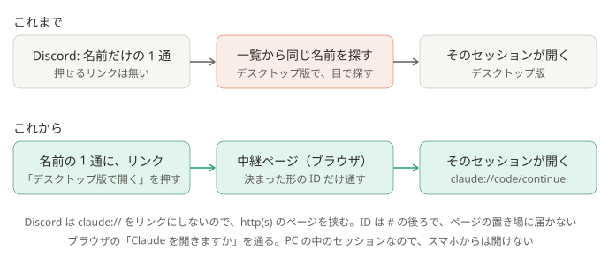

# ADR-0040: 名前の 1 通に、デスクトップ版でそのセッションを開くリンクを、中継ページを通して足す

## 背景と課題

- 取り込む設定（`desktop_import: true`）では、結果のあとに、セッションの名前だけの 1 通が届く。PC の Discord でこれを見て、続きをデスクトップ版でやるときは、
  一覧から同じ名前を探して開いていた。押せば開くリンクがほしい。
- デスクトップ版は、`claude://code/continue?session=local_<ID>` でそのセッションを開く（[ADR-0035](0035-return-to-viewed-session.md) で、表示を戻すのに使っている）。
  取り込んだセッションは、`local_<claude -p のセッション ID>` で載る。公開の説明には無い形。
- Discord は、`claude://` をリンクにしない。リンクにするのは http・https・discord・tel・sms・mailto だけで、ほかはただの文字になる（2026-10-23 に、Discord のウェブ版のコードで確かめた）。

## 決定

- 中継ページ `docs/open.html` を置く。ページは、URL の `#` の後ろが `local_<UUID>` の形のときだけ、`claude://code/continue?session=local_<UUID>` を開く。ほかの形は開かない。
- 設定 `desktop_link_page` に、そのページを開ける http(s) の URL を書くと、名前の 1 通の下の行に `[デスクトップ版で開く](<ページ#local_<ID>>)` を足す。
  空（既定）なら、これまでどおり名前だけ。ID がその形でないときも、足さない。
- ページの置き場は、使う人が決める（GitHub Pages、PC の中の http サーバーなど）。この仕組みは、ページを出すものを動かさない。

### 結果

- 得るもの: PC の Discord から、押すとデスクトップ版でそのセッションが開く（2026-10-23 に、PC の中のサーバーに置いたページで確かめた）。
- 引き受けるもの:
  - 押すと、Discord の外部リンクの確認、ブラウザのタブ、ブラウザの「Claude を開きますか」が出る。確認は、どちらも次から聞かないようにできる。タブは残る。
  - スマホからは開けない（セッションは、仕分けた PC にしかない）。
  - 長押しで名前を写すと、リンクの行も一緒に写る。
  - ページの置き場を、使う人が用意する。置き場が止まると、リンクが開かないだけ（仕分けは変わらない）。
  - デスクトップ版の中の形（`claude://code/continue`）に頼る。変わると開かなくなる。

## 採らなかった案

- `claude://` のリンクを、そのまま書く: Discord が押せる形にしない。
- 仕分けの側で http サーバーを動かす: 常駐するプロセスを足さない決まりに反する。
- ページが、渡された `claude://` にそのまま飛ぶ: そのページへのリンクを誰かが作ると、プロンプトを書き込んだ新しいセッション（`claude://code/new?q=…`）などを
  開かせられる。セッションを開く形だけに絞る。

## 補足

- ID を `#` の後ろに入れるのは、ブラウザがその部分をページの置き場へ送らないため（置き場のログに ID が残らない）。ページは、外のスクリプトや画像を読まない。
- 関連: [しくみ](../how-it-works.md)、[setup.md](../setup.md)、`docs/open.html`、`pipeline/desktop_view.py`
