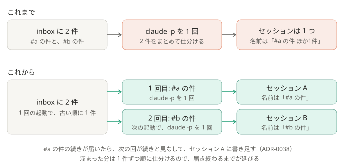

# ADR-0041: 1 回の仕分けで扱うメンションは 1 件にし、別々のメンションを同じセッションにしない

## 背景と課題

- `dispatch.py` は、`inbox/` にある件をぜんぶ claim し、`claude -p` を 1 回動かして仕分けていた。仕分けのセッションは、この 1 回ごとに 1 つ。
- そのため、届いた時刻が近いというだけで、別の場所の、話の違うメンションが、1 つのセッションに入っていた。PC が止まっていた間や、Claude が動いている間に溜まった分は、とくにそうなる。
- そのセッションは、代表の件の名前（「… ほか1件」）で、デスクトップ版の一覧に 1 つだけ載る。ほかの件の続きを相談するときも、別の件の名前のセッションを開くことになり、ほかの件の話が同じ会話に混ざる。
- 同じ流れの続き（[ADR-0036](0036-continue-the-same-flow.md)、[ADR-0038](0038-add-to-the-same-session.md)）は、claim した件がぜんぶ同じ場所にあるときだけ効く。場所がまたがる回は、どの流れも引き継げなかった。
- `inbox/` には、もともと 1 ファイルに 1 件で書き出している（`watcher/store.py` の `write_inbox`）。

## 決定

- `dispatch.py` は、1 回の起動で、`inbox/` の古い順に **1 件だけ** claim して仕分ける（`PER_RUN = 1`）。残りは `inbox/` に残り、次の起動（2 分おき。Claude が動いている間の起動は、何もせずに終わる）が、また 1 件取る。
- 1 件ごとに `claude -p` を 1 回動かすので、セッションも 1 件に 1 つ。名前は、その件から作る。
- 同じ流れの続きの件は、前の件の回が控えた場所とメッセージ ID から、次の回が続きと見なし、前の件のセッションに書き足す（これまでの仕組みのまま。[ADR-0039](0039-end-the-idle-desktop-process.md) も同じ）。同じスレッドで続けて届いた件は、1 つのセッションに並ぶ。
- 認証切れなどで仕分けを止めている間は、これまでどおり claim しない。

### 結果

- 得るもの: 1 つのセッションには、1 件か、同じ流れの件だけが入る。結果の各件に付くセッションの名前が、その件のものになる。場所がまたがって溜まった回でも、それぞれの流れを引き継げる。
- 引き受けるもの:
  - 溜まった分は 1 件ずつ順に仕分けるので、届き終わるまでが延びる。1 件ごとに、仕分けの時間と、次の起動までの最大 2 分がかかる（5 件なら、まとめて 1 回より十数分遅れうる）。
  - Claude を動かす回数が、件の数だけ増える。前の会話やリポジトリを毎回読み直すので、利用枠の減りが早くなる。
  - 同じ流れかどうかは、前の会話（`context_before`）に前の件が入っているかで見る。同じ場所に続けて届いた件でも、前の会話に前の件が無ければ、別のセッションになる。

## 採らなかった案

- 場所（チャンネル・スレッド）ごとにまとめて 1 回: 同じチャンネルの別の話題が、同じセッションに入る。同じ流れの件は、続きの仕組みで 1 つのセッションに並ぶので、まとめる必要が無い。
- 1 回の起動の中で、1 件ずつ続けて仕分ける（次の起動を待たない）: 溜まった分は早く終わるが、ロックを持つ時間が件の数だけ延び、その間の検索も止まる。認証切れなどで止める判定も、件ごとに入れ直すことになる。まずは単純な形にし、遅さが困るようなら考える。
- いまのまま（まとめて 1 回）: 上の課題が残る。

## 補足

- 一部を変えた ADR:
  - [ADR-0043](0043-name-sessions-from-the-reply.md): セッションの名前は、その件から機械的に作るのではなく、その件の返答を書いた仕分けの Claude が付ける
- この ADR が一部を変えた ADR:
  - [ADR-0014](0014-poll-search-api-single-entry.md): Claude が動いている間の新着は、終わったあとの回が「まとめて」ではなく、1 件ずつ仕分ける（検索で拾うのは、これまでどおりまとめて）
- 関連: [しくみ](../how-it-works.md)、`pipeline/dispatch.py`、`pipeline/continuation.py`
