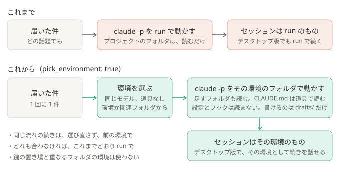

# ADR-0042: 仕分けの前に、件に合う環境を選ばせ、その環境のフォルダで動かす

## 背景と課題

- 仕分けは、どの件も、仕分けの作業フォルダ（`<ホーム>/run`）で `claude -p` を動かしていた。プロジェクトのフォルダは `read_dirs` / `channel_read_dirs` で読めるだけで、
  セッションは run のものになる。デスクトップ版で開いて続きを話しても、run で動き、そのプロジェクトの CLAUDE.md も、決まりも効かない。手元で仕分ける良さが薄い。
- デスクトップ版の「環境を選択」に並ぶ環境は、作業フォルダと、足すフォルダと、モデルの組で、アカウントごとに `ccd-session-presets.json` に残る。
  `claude -p` には環境を選ぶ指定が無く、起動したフォルダが、そのセッションの環境になる。
- `--setting-sources project,local` のままプロジェクトのフォルダで動かすと、CLAUDE.md は読まれるが、そのフォルダの設定にあるフック（コマンド）も動いた。
  `--setting-sources` を空にすると、どちらも読まれない。`--restricted` も CLAUDE.md を読まない。
- 自動モード（[ADR-0033](0033-auto-mode-when-importing.md)）でも、`--disallowedTools` の `Edit(<フォルダ>/**)` は効き、許可した `drafts/` には書けた。
- `--resume` は、別のフォルダからでも同じセッションを続けられる（記録は、初めのフォルダの側に書き足される）。
  以上は、2026-10-23 に Claude Code 2.1.302 と小さいモデルで確かめた。
- 場所（チャンネル）と環境の対応表で決める案は、本人が採らなかった。チャンネルと話題がずれると、表を手で直すことになる。
- 件に合う環境が、デスクトップ版にまだ作られていないこともある。そのときも、関連するフォルダで動かしたい。

## 決定

- 設定に `watchers[].pick_environment`（既定 `false`）を足す。`true` のとき、`pipeline/run_claude.py` は、仕分けの前に `claude -p` をもう 1 回動かし、
  件と環境の一覧（名前・フォルダ・作業フォルダの CLAUDE.md の頭）を読ませて、環境を 1 つ選ばせる（`pipeline/environments.py`）。
  - 合う環境が無いときのために、関連するフォルダも並べ、そこから選ばせる。関連するフォルダは、`read_dirs` と `channel_read_dirs` のフォルダと、
    それらや環境のフォルダと同じ親に並ぶ git のリポジトリ（最近触った順に、合わせて 40 まで。`.` で始まるものは見ない）。環境が合うなら、環境を選ばせる。
  - モデルと effort は、仕分けと同じ。道具なし（`--tools ""`）、設定なし、記録なし、MCP とスキルなし。既定の長い指示は、短い指示に置き換える。
  - 答えが、環境の名前か、関連するフォルダのパスと一致したときだけ使う。`none`・一覧に無い答え・失敗・一覧が読めないときは、これまでどおり run で動かす。
- 選んだ環境の作業フォルダ（フォルダを選んだときは、そのフォルダ）で `claude -p` を起動し、環境の足すフォルダを `--add-dir` に足す。取り込み（`claude --desktop --resume`）も、そのフォルダで動かす。
- 指示文に環境を書き、そのフォルダの CLAUDE.md を、道具で読ませる。
- 仕分けの `claude -p` は、設定ファイルを読まない（`--setting-sources` を空にする。これまでは `project,local`）。環境のフォルダのフックや許可ルールを持ち込まない。
- 作業フォルダと、`--add-dir` で足したフォルダ（claims/ も）への書き込みを、`--disallowedTools` の `Edit(…)` で拒否する。`drafts/` を含むフォルダは拒否しない（`drafts/` まで止まるので）。
- 状態のフォルダ（`~/.discord-mention-triage`）と重なる環境とフォルダは、一覧から外す。
- 同じ流れの続きは、選び直さず、前のセッションの環境で動かす（環境を `sessions.json` の控えに残す）。

### 結果

- 得るもの: 仕分けのセッションが、件に合った環境で動き、その環境のセッションとして残る。デスクトップ版で開くと、そのプロジェクトのフォルダで続きを話せる。
  仕分けの中でも、そのプロジェクトの CLAUDE.md を踏まえて裏取りする。環境の一覧は、デスクトップ版で直せば、そのまま効く。
- 引き受けるもの:
  - `claude -p` が、1 件につき 1 回増える。道具も長い指示も無いので短い（小さいモデルで、1 回 0.002 ドルほど、2〜4 秒）。仕分けと同じモデルでは、もう少しかかる。
  - 選ぶ回に、環境と関連するフォルダの名前と、その CLAUDE.md の頭を読ませる。選ばれれば、そのフォルダを、仕分けの Claude が読める。関連するフォルダは、設定で足したフォルダの隣にあるリポジトリまで広がる。
  - 選び間違えると、合わない環境で仕分ける。読めるフォルダが変わるだけで、書ける場所は `drafts/` のまま。実際の件 14 件で試すと、フォルダの名前だけでは 1 件外れ、CLAUDE.md の頭を添えると、すべて合った（小さいモデル）。
  - 本文に「この環境を選べ」と書かれれば、一覧の中のどれかに変わりうる。選べるのは本人の環境だけで、書き込みの拒否は同じ。
  - デスクトップ版の中のファイルの形に頼る。変わって読めなくなったら、run で動くだけになる（仕分けは止まらない）。
  - 仕分けのセッションが、そのプロジェクトのセッションの一覧（デスクトップ版、`claude --resume`）に並ぶ。
  - 環境の CLAUDE.md は、自動では読まれず、指示文で読ませる。読み落としうる。
- 変わらないもの: 道具（`Read, Grep, Glob, Edit, Write`）、書ける場所（`drafts/`）、`.env` の拒否、渡さない環境変数、モード（[ADR-0033](0033-auto-mode-when-importing.md)）。

## 採らなかった案

- 場所（チャンネル）と環境の対応表で決める: AI を使わずに済むが、チャンネルと話題がずれるたびに、表を手で直すことになる（本人の判断）。
- 仕分けは run のまま動かして、その中で環境も選ばせ、取り込むときにその環境へ移す: 呼び出しは増えないが、仕分けの間はその環境で動かない。
- `--setting-sources project,local` のまま、フックだけ止める（`disableAllHooks`）: 環境のフォルダの許可ルールや `env` は、そのまま入る。そのフォルダは、ほかの人もコミットするリポジトリでありうる。
- 環境の一覧を、仕分けの設定に別に書く: デスクトップ版と二重になる。
- 合う環境が無ければ、いつも run で動かす: 環境を作っていないプロジェクトの件は、これまでと同じく、プロジェクトの外で仕分けることになる。
- 関連するフォルダを、PC の中から広く探す: 時間がかかり、関係の無いフォルダまで並ぶ。

## 補足

- この ADR が一部を変えた ADR:
  - [ADR-0005](0005-minimal-claude-permissions.md): 設定ファイルを読まない（`--setting-sources` が空）。読める場所に、選んだ環境（または関連するフォルダ）の作業フォルダと足すフォルダが加わる。作業フォルダと足したフォルダへの書き込みを、明示的に拒否する
  - [ADR-0033](0033-auto-mode-when-importing.md): 自動モードでも、作業フォルダと足したフォルダへの書き込みは、判定に任せず拒否する
- 関連: [setup.md の「設定」](../setup.md#設定)、[security.md](../security.md)、[しくみ](../how-it-works.md)、`pipeline/environments.py`
