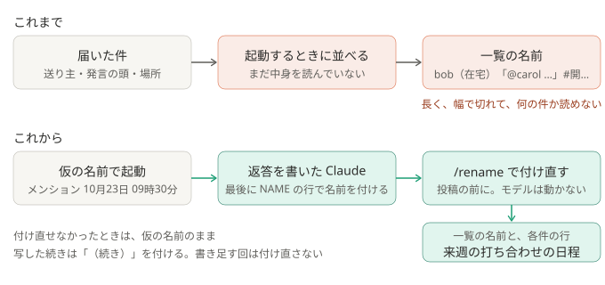

# ADR-0043: セッションの名前は、返答を書いた仕分けの Claude が、中身を見て付ける

## 背景と課題

- 仕分けのセッションの名前は、デスクトップ版の左の一覧と、結果の各件の最後の行（`セッション: <名前>`）に出る。本人は、この名前で件を見分け、続きを頼む。
- 名前は、起動するときに `--name` で付けていた。起動の時点では件の中身を読んでいないので、届いた件から機械的に `<送り主>「<発言の頭>」#<場所>` を作っていた。
- 実際の一覧では、何の件かが読めなかった。サーバーの中の表示名には読みや状態が並ぶことがあり、それだけで幅の半分を使う。発言の頭は、挨拶や、
  ほかの人へのメンション、識別子の並びのことが多く、用件を表さない。チャンネル名も長い。一覧は幅で切れるので、用件の前で切れる。
  形を決めて作り直すより、件の中身を読んだ Claude に、そのつど短く付けさせたい。
- 確かめたこと（2026-10-23、Claude Code 2.1.302。小さいモデルで）:
  - `claude -p --resume <ID> "/rename <名前>"` は、モデルを動かさずに、セッションの名前を付け直す（費用は増えない）。
    結果の返答は `Session renamed to: <名前>`。記録の最後に、/rename の行と、その出力の行が残る。
  - 仮の名前で起動し、付け直してから `claude --desktop --resume <ID>` で取り込むと、デスクトップ版の一覧に新しい名前で載り、モードも記録どおり（自動）だった。

## 決定

- 仕分けの Claude は、最後の返答の終わり（COUNTS の行の前）に、`NAME <名前>` の行を書く。書き上げた返答を読み返し、何の件かを、自分の言葉で、
  全角 20 字までで付ける。形は決めない。送り主の表示名やチャンネル名を、そのまま並べない（`pipeline/prompts/triage.md`）。
- Python は、投稿の前に、返答の終わりの NAME の行を外し、名前を通してよい文字だけにして（幅は全角 20 字ぶんで切る）、
  `claude -p --resume <ID> "/rename <名前>"` で付け直す（`run_claude.rename_command`）。道具・設定ファイル・MCP は渡さず、`--max-turns 1`。
  モードは仕分けと同じ。作業フォルダも、仕分けと同じ（[ADR-0042](0042-run-in-the-chosen-environment.md)）。
- 起動するときは、仮の名前（`メンション 10月23日 09時30分` の形）を `--name` で付ける。名前が無い・付け直せなかったときは、仮の名前のまま。
  各件の最後の行の名前は、付け直せたときだけ新しい名前にし、デスクトップ版の一覧とそろえる。仕分けは、付け直しの成否で止めない。
- 前の会話を写した続き（[ADR-0036](0036-continue-the-same-flow.md)）は、付けた名前の後ろに「（続き）」を付ける。
  前のセッションに書き足す回（[ADR-0038](0038-add-to-the-same-session.md)）は、付け直さない（前の件の行に出した名前と、そろえておく）。
- 届いた件から名前を作る処理（送り主・発言の頭・場所）と、そのためだけに受付が残していた `mention_names` を外す。
- 実行記録には、付け直しの結果（`rename`: `ok` / `no_name` / `unexpected` / `exit_<コード>` など）だけを書き、名前は書かない。

### 結果

- 得るもの: 一覧と各件の行で、何の件かが読める。名前は、返答と同じ読み方から付くので、仕分けの中身と合う。
- 引き受けるもの:
  - 仕分けのたびに、`claude` をもう 1 回起動する（モデルは動かない）。数秒かかる。
  - デスクトップ版でセッションを開くと、最後の返答のあとに、/rename の行が見える。
  - 名前の付け方は、モデルに任せる。形はそろわない。名前は、本文に引きずられうる。通す文字を決め打ちにし（cmd.exe に効く文字を通さない）、長さを切る。
  - /rename の形が変わって付け直せなくなったら、仮の名前が残る（実行記録の `rename` で分かる）。
  - 書き足していく流れは、最初の件で付けた名前のまま。話題が移っても、名前は変わらない。

## 採らなかった案

- 届いた件から作る形を、短く作り直す（送り主や場所を外す、など）: 形を決めることになり、要望に合わない。発言の頭は、用件を表さないことが多い。
- 仕分けの前に、別の 1 回で名前だけ付けさせる（環境を選ぶ回と一緒に）: 返答の中身を見ずに付けることになる。環境を選ぶ設定のときしか動かない。
- セッションの記録（`~/.claude/projects/…/<ID>.jsonl`）に、名前の行を直接書き足す: 試すと効いたが、Claude Code の中の形に書き込むことになる。
  /rename は、Claude Code が用意している操作。
- 仕分けの Claude 自身に /rename させる: 仕分けの Claude は、スラッシュコマンドもスキルも使えない（[ADR-0005](0005-minimal-claude-permissions.md)）。広げない。
- 名前を構造化出力（`--json-schema`）で受け取る: 最後の返答が、そのまま投稿本文になる形（[ADR-0037](0037-reply-is-the-posted-text.md)）が変わる。

## 補足

- この ADR が一部を変えた ADR:
  - [ADR-0009](0009-import-sessions-into-desktop.md): セッションの名前は、起動するときの仮の名前のあと、仕分けの Claude が返答の中身から付けた名前に付け直す
  - [ADR-0041](0041-one-mention-per-run.md): 名前は、その件から機械的に作るのではなく、その件の返答から、仕分けの Claude が付ける
- 関連: [しくみ](../how-it-works.md)、[security.md](../security.md#プロンプトインジェクション)、`pipeline/session_naming.py`、`pipeline/run_claude.py`
