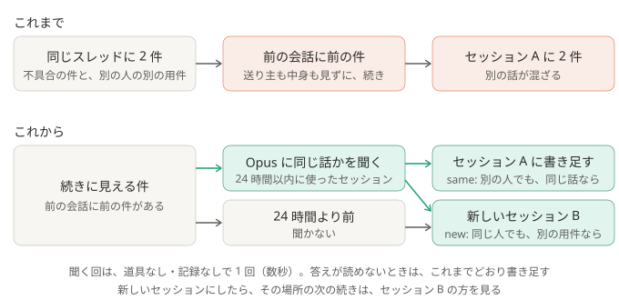

# ADR-0044: 同じ場所の続きでも、前の件と同じ話かを Sonnet に聞き、別の話か、24 時間より前のセッションなら、新しいセッションで仕分ける

## 背景と課題

- 続きの見分け方（[ADR-0036](0036-continue-the-same-flow.md)）は、同じ場所（スレッド。スレッドでなければチャンネル）で、前に仕分けた件が、今回の件の前の会話（既定 15 件）に入っているか、だけを見る。送り主も中身も見ない。
- そのため、同じスレッドで、別の人が別の用件でメンションしても、前の件のセッションに書き足していた。スレッドでないチャンネルでも、直前 15 件に前の件があれば、話題が違っても入る。1 つのセッションに別の話が混ざり、続きを相談するときに読み分けることになる。[ADR-0041](0041-one-mention-per-run.md) は、同じ回に届いた別々の件を分けたが、この場合は残っていた。
- 続きの仕組みは、セッションが増えすぎないためのもの。何日も前の流れまでつなぐ必要は無い。ADR-0036 では、続ける期限を設けなかった。
- 確かめたこと（2026-10-24、作り物の件で）: 同じ不具合の話を別の人が続けた件は same、同じ人の別の用件と、別の人の別の用件は new と答えた。最新の Sonnet は 1 回 3〜4 秒、費用は 0.004 ドルほど。haiku も同じ答えで、費用は 10 分の 1 ほどだった。

## 決定

- 続きと見なした回（ADR-0036 の条件に当たる回）は、続ける前に、前のセッションが最後に使われた時刻を見る。時刻は、記録（`~/.claude/projects/*/<ID>.jsonl`）の最終更新で、仕分けで書き足した分も、本人がデスクトップ版で話した分も入る。
  - 24 時間より前なら、聞かずに、新しいセッションで仕分ける。
  - 24 時間以内なら、最新の Sonnet（`--model sonnet`。別名なので、新しい版が出れば、それに替わる）を、道具なし・設定なし・記録なしで 1 回動かす。前のセッションの名前、前に仕分けた件、そのあとの発言（5 件まで）、今回のメンションを読ませ、same か new だけを答えさせる。送り主が違っても同じ話なら same、迷うときも same。new なら、新しいセッションで仕分ける。
  - 答えが読めない・動かせないときは、これまでどおり続ける。
- 新しいセッションにした回は、その場所の控え（`sessions.json`）を、新しいセッションに置き換える。次の続きは、新しいセッションの方を見る。
- 実行記録に、判定（same / new / stale / error）と、聞いた回の費用を書く。本文は書かない。設定の項目は足さない。

### 結果

- 得るもの: 1 つのセッションに入るのは、同じ話の件だけになる。別の人が同じ話を続けた件は、これまでどおり同じセッションに入る。
- 引き受けるもの:
  - 続きの候補が出るたびに、claude を 1 回多く動かす（数秒と、わずかな利用枠）。
  - 判定を外すことがある。別の話を same とすれば、これまでどおり混ざる。同じ話を new とすれば、前の会話を知らないセッションになる。
  - 控えは場所ごとに 1 つなので、別の話で新しいセッションにしたあと、元の話の続きが届くと、新しい方と比べる。元のセッションには戻らない。
  - 24 時間空いた流れは、同じ話でも新しいセッションになり、前の会話を引き継がない。

## 採らなかった案

- 送り主が前の件と違えば、新しいセッションにする: AI を使わないが、同じ話に別の人が加わったときも分かれる。チームのスレッドでは、よくある。
- 仕分けの Claude に判断させる: 前のセッションに書き足すか、新しく始めるかは、起動する前に決める必要がある。
- 別の場所も含め、24 時間以内のセッションから同じ話のものを探す: 候補を並べて選ばせる仕組みが要る。まずは、同じ場所の続きの誤りを直す。
- haiku で聞く: 最初はこれにした。試した 3 件は Sonnet と同じ答えで、費用は 10 分の 1 ほど。使う人の判断で、最新の Sonnet にした。
- 仕分けと同じモデル（既定は opus）で聞く: same か new を答えるだけで、仕分けほどの重さは要らない。

## 補足

- この ADR が一部を変えた ADR:
  - [ADR-0036](0036-continue-the-same-flow.md): 続きと見なしても、24 時間より前に使われたセッションと、前の件と別の話には、続けない（「続ける期限を設けない」を変えた）
- 関連: [しくみ](../how-it-works.md)、[security.md](../security.md)、`pipeline/same_topic.py`、`pipeline/continuation.py`
