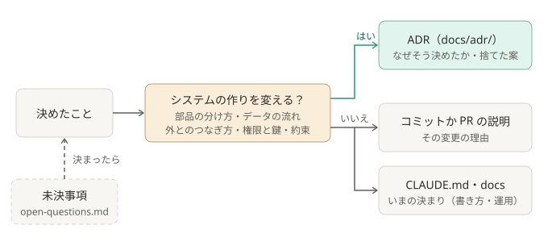

# ADR（設計上の決定の記録）

システムの作りを、なぜそう決めたか、何を捨てたかを残す。1 つの決定につき 1 ファイル。
形は [MADR](https://adr.github.io/madr/) 4.0 に合わせている（外から読む人が、見慣れた形で読めるように）。

## 一覧

| 番号 | 決定 | 状態 | 日付 |
|---|---|---|---|
| [0003](0003-scheduler-outside-claude.md) | 定期実行は Claude の外に置き、新着があるときだけ `claude -p` を起こす | accepted（一部を変更） | 2026-10-03 |
| [0004](0004-unattended-triage-without-pr-review.md) | 仕分けは無人化し、PR の自動レビューは無効にする | accepted | 2026-10-03 |
| [0005](0005-minimal-claude-permissions.md) | 仕分けの Claude に渡す権限を最小にする | accepted（一部を変更） | 2026-10-03 |
| [0008](0008-keep-session-transcripts.md) | セッション記録は本番も残す | accepted | 2026-10-04 |
| [0009](0009-import-sessions-into-desktop.md) | 仕分けのたびに、セッションをデスクトップ版へ取り込む | accepted（一部を変更） | 2026-10-04 |
| [0012](0012-pin-unattended-runs-to-a-token.md) | 無人実行は専用の長期トークンで動かし、`claude` のログインに頼らない | accepted | 2026-10-05 |
| [0014](0014-poll-search-api-single-entry.md) | 取得は検索 API を数分おきに引く形にし、常駐をやめて、入口を 1 つにする | accepted（一部を変更） | 2026-10-09 |
| [0015](0015-one-command-one-folder.md) | 入口のコマンドを 1 つ、設定と鍵の置き場を 1 つにする。配るときは、フォルダをそのまま渡す | accepted（一部を変更） | 2026-10-10 |
| [0018](0018-per-person-bot-no-shared-host.md) | ほかの人が使うときも、各自が自分のボットを作る。共有のホストは作らない | accepted | 2026-10-10 |
| [0020](0020-keep-the-bot-no-user-token.md) | メンションの取得には、ボットを使い続ける。本人のログイントークンで読む経路は、採らない | accepted | 2026-10-10 |
| [0031](0031-stay-on-subscription-not-api-credits.md) | 無人実行はサブスクの利用枠で動かし、Max / Team の月額 API クレジットには切り替えない | accepted | 2026-10-12 |
| [0032](0032-run-on-your-own-pc.md) | 仕分けは、Claude Code が入った自分の PC で動かす。PC の外で動かす形は、オプションとしても入れない | accepted | 2026-10-12 |
| [0033](0033-auto-mode-when-importing.md) | デスクトップ版へ取り込む設定のときは、仕分けを「自動」モードで動かす | accepted | 2026-10-16 |
| [0034](0034-per-channel-read-dirs.md) | チャンネルごとに、仕分けの Claude が読むフォルダを足せるようにする | accepted | 2026-10-16 |
| [0035](0035-return-to-viewed-session.md) | デスクトップ版へ取り込んだあと、見ていたセッションへ表示を戻す | accepted | 2026-10-16 |
| [0036](0036-continue-the-same-flow.md) | 同じ流れの続きのメンションは、前の仕分けの会話を写したセッションで仕分ける | accepted | 2026-10-16 |
| [0037](0037-reply-is-the-posted-text.md) | 投稿本文は、仕分けの Claude の最後の返答で受け取る | accepted | 2026-10-19 |
| [0038](0038-add-to-the-same-session.md) | 同じ流れの続きは、前のセッションがどこでも開かれていなければ、そのセッションに書き足す | accepted | 2026-10-21 |

「一部を変更」は、どこが変わったかを、その ADR の補足に書いている。番号が飛んでいるのは、システムの作り以外の記録を、公開版に含めていないため。

## ADR に書くもの

**システムの作りを決めたときだけ書く。** 部品の分け方、データの流れ、外とのつなぎ方、権限と鍵、[約束](../security.md#約束)を変える決定。

それ以外は、ADR にしない。

- 細かい振る舞い、セットアップの手順、文書の構成を決めたら、理由は、そのコミットか PR の説明に書く。
- いまの決まり（文書の書き方、ADR の運用など）は、[CLAUDE.md](../../CLAUDE.md) か、該当する docs のページに書く。
- まだ決まっていないことは [未決事項](../open-questions.md) に書く。決まったら、上の分け方で書き、未決事項から外す。

## 書き方

[template.md](template.md) を `NNNN-短い英語の題.md`（次の番号）に写して書き、上の一覧に 1 行足す。

- 1 画面に収まる長さにする。実装の細かい手順や使い方は、[しくみ](../how-it-works.md) / [setup.md](../setup.md) / [security.md](../security.md) に書く。
- **基本的に、図を 1 枚入れる。** 題のすぐ下に置き、決定で何がどう変わるかを見せる。SVG を [figs/](figs/) に、`NNNN-短い英語の題.svg` で置く。
- `status` は `proposed` / `accepted` / `rejected` / `deprecated` / `superseded by ADR-NNNN` のどれか。
- `date` は決めた日。

## 運用のルール

- **過去の ADR は書き換えない。** 決定を変えるときは、新しい ADR を足す。
  - 丸ごと変えたら、古い方の `status` を `superseded by ADR-NNNN` にする。
  - 一部だけ変えたら、古い方の front matter に `amended-by: [ADR-NNNN]` を足し、補足に何を変えたかを書く。
  - ADR にしない変更で、古い ADR の一部が古くなったら、補足の「その後変わった所」に、何が変わったかと、いまの形が書いてあるページを書く。
  - どれも、変更と同じコミットで直す。
- そのまま直してよいのは、誤字、リンク切れ、図の追加、秘密・組織の事情・ほかの人の名前。
