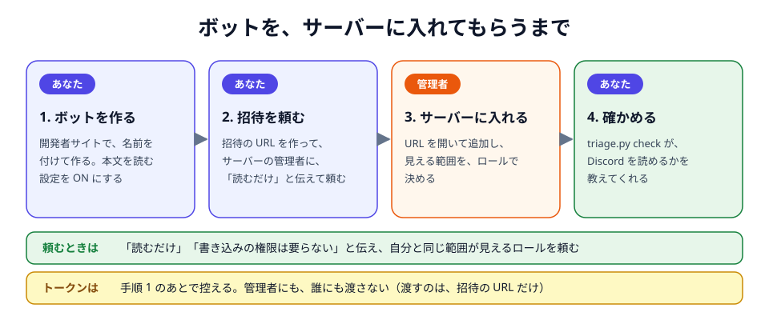
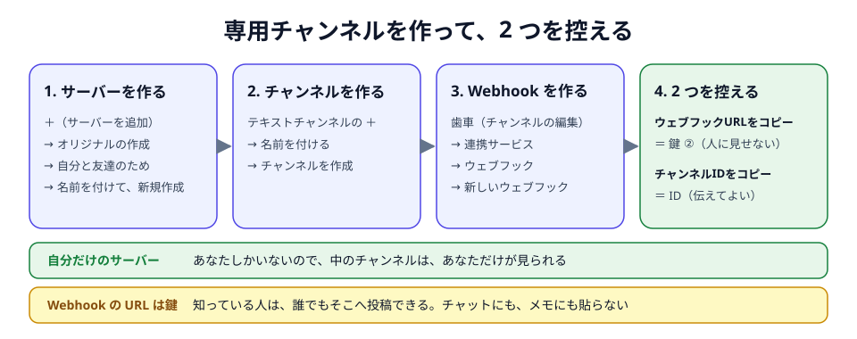

# Discord 側と鍵を用意する

セットアップの手順 2 と 3 を、自分の手で進めるときの早見です。スキル（`/triage-setup`）を使えば、Claude in Chrome がつながっている間は、画面の操作を Claude が進めます。
画面の言葉は、2026-10-10 の日本語の画面のものです。

| 用意するもの | 秘密か | 書く所 |
|---|---|---|
| 鍵 ① ボットのトークン | 秘密 | `~/.discord-mention-triage/.env` |
| 鍵 ② Webhook の URL | 秘密 | `~/.discord-mention-triage/<名前>/.env` |
| 鍵 ③ Claude の OAuth トークン | 秘密 | `~/.discord-mention-triage/<名前>/.env` |
| 自分のユーザー ID、専用チャンネルの ID | 秘密ではない | Claude に伝える（設定に入る） |

人に頼むのは、ボットの招待だけです。返事を待つので、最初に頼んでおきます。

## 1. ボットを作る

1. [Developer Portal](https://discord.com/developers/applications) → **New Application** → 名前を付けて作る（例: `MentionTriage`）。
2. **Bot** → **Message Content Intent** を ON → 保存。OFF だと、メンションの本文が空で届きます。
3. 同じページの **公開Bot** は ON のまま。OFF だと、管理者が招待できません。
4. **一般情報** の **アプリID** を控える（秘密ではありません）。

ボットは、1 人に 1 つ作ります。トークンは、管理者にも、同僚にも渡しません（[ADR-0018](adr/0018-per-person-bot-no-shared-host.md)）。

## 2. 管理者に招待してもらう



招待 URL は、`<アプリID>` を、自分のアプリ ID に置き換えて使います。

```text
https://discord.com/oauth2/authorize?client_id=<アプリID>&scope=bot&permissions=0
```

`permissions=0` で招待し、見える範囲は、ロールで決めてもらいます。要るのは「チャンネルを表示」と「メッセージ履歴を読む」だけです。

依頼文の例です。

```text
お疲れさまです。自分宛てのメンション対応を楽にするため、読み取り専用のボットを、このサーバーに入れていただけないでしょうか。

・すること: 私宛てのメンションと、その前後の会話を読み、AI（Claude）が「返信が要るか」を仕分けます。
・しないこと: Discord への書き込み（返信・スタンプ・編集・削除）は、しません。その機能を持っていません。
・本文の行き先: 読んだ本文は、AI（Claude。私の契約）に送られます。仕分けの結果（メンションの引用を含みます）は、私だけが見られるチャンネルに届きます。
・仕組み: https://github.com/umezy/discord-mention-triage （私の PC で動きます）
・招待 URL: https://discord.com/oauth2/authorize?client_id=<アプリID>&scope=bot&permissions=0
・見せてほしい範囲: 私と同じ範囲が見えるロールを付けていただけると助かります。書き込みの権限は、要りません。
```

- **ロールについて:** 頼んだ人と同じロールが付くことがあります。そのロールに書き込みの権限があっても、この仕組みは、書き込む機能を持ちません（[約束](security.md#約束)）。
- **見られる範囲が変わったら:** ボットは、あなたとは別のメンバーです。異動などで、あなたのロールが外れても、ボットのロールは、自動では外れません。管理者に、ボットのロールも直してもらいます。使うのをやめるときは、ボットを、サーバーから外してもらいます。

招待を待つ間に、3 から先を進めておけます。

## 3. 専用チャンネルと Webhook を作る

仕分けの結果が届く、自分だけが見るチャンネルです。結果にはメンションの引用が入り、機密を含むことがあるので、ほかの人が見られない場所にします。



1. サーバー一覧の **＋**（サーバーを追加）→ **オリジナルの作成** → **自分と友達のため** → **新規作成**。
2. **テキストチャンネル** の **＋** → 名前を付ける（例: `mention-triage`）→ **チャンネルを作成**。最初からある「一般」でも構いません。
3. チャンネルの歯車 → **連携サービス** → **ウェブフック** → **新しいウェブフック**。
4. チャンネルを右クリック → **チャンネルIDをコピー**。

- ほかの人もいるサーバーに作るなら、プライベートチャンネルにします。ウェブフックを管理できる権限も要ります。
- Webhook の URL は鍵です（知っている人は、誰でもそこへ投稿できます）。人に見られたら、**ウェブフックを削除** で消して、作り直します。

## 4. 自分のユーザー ID

自分の名前を右クリック → **ユーザーIDをコピー**。出ないときは、ユーザー設定 → **開発者** → **開発者モード** を ON にします。

## 5. 鍵を 3 つ、`.env` に書く

| 鍵 | 手に入れる所 | 書く所 |
|---|---|---|
| ① ボットのトークン | Developer Portal → 自分のアプリ → **Bot** → **トークンをリセット**（表示は 1 回だけ） | `~/.discord-mention-triage/.env` の `DISCORD_BOT_TOKEN=` |
| ② Webhook の URL | 専用チャンネルの歯車 → **連携サービス** → **ウェブフック** → **ウェブフックURLをコピー** | `~/.discord-mention-triage/<名前>/.env` の `DIGEST_WEBHOOK=` |
| ③ Claude の OAuth トークン | 自分のターミナルで `claude setup-token` → ブラウザで、仕分けに使うアカウントを承認 → 表示された文字列（1 年有効） | `~/.discord-mention-triage/<名前>/.env` の `CLAUDE_CODE_OAUTH_TOKEN=` |

`.env` は、セットアップ（`python triage.py init`）が作ります。メモ帳で開いて、`=` の直後に、空白も引用符も入れずに貼って保存します。
書けたかは、`python triage.py check` が、鍵を出さずに教えてくれます。

> [!WARNING]
> **鍵 ③ のアカウントは、本文を学習に使わせない設定にしておく。**
> 個人の契約（Free / Pro / Max）では、[claude.ai の 設定 → プライバシー](https://claude.ai/settings/data-privacy-controls) の **Help improve our AI models** が ON だと、メンションの本文が、モデルの学習に使われます
> （Claude Code から送った分も含みます。送った本文と Claude の返答が、Anthropic のサーバーに残る期間も、30 日から 5 年に延びます）。会社の契約（Team / Enterprise）では、使われません。
> 根拠は、Anthropic の [Data usage](https://code.claude.com/docs/en/data-usage) と [プライバシーセンター](https://privacy.claude.com/en/articles/10023580-is-my-data-used-for-model-training) です。

> [!CAUTION]
> **してはいけないこと**
> - 鍵を、チャットに貼る
> - `claude setup-token` を、Claude に実行させる（出力が、会話に残ります）
> - すでに動いているボットで **トークンをリセット** を押す（前のトークンが失効します）

`claude` が「認識されません」と出たら、まだ入っていません（[`claude` を入れる](setup.md#claude-を入れる)）。

## よくあるつまずき

| 起きること | 原因と、すること |
|---|---|
| `ボットのトークン: 無い` | `.env` に書けていない。行の形（`名前=値`）と、保存を確かめる |
| `http_401…` | トークンが違う。**トークンをリセット** して、貼り直す |
| `http_403…` | まだ招待されていない、または「メッセージ履歴を読む」が無い。管理者に確かめる |
| メンションは届くが、本文が空 | **Message Content Intent** が OFF |
| 管理者が、ボットを招待できない | **公開Bot** が OFF |
| `Webhook: 無い`、または専用チャンネルに何も届かない | 鍵 ② を書けていない、または Webhook を消した。作り直して、貼り直す |
| `claude_auth` | 鍵 ③ が無い、違う、または切れた。`claude setup-token` をやり直す |

ここに無いときは、[困ったとき](troubleshooting.md)。
