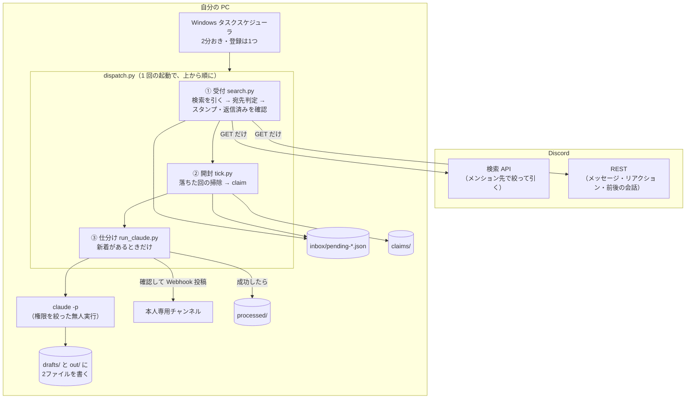

# しくみ

タスクスケジューラが 2 分おきに `pipeline/dispatch.py` を起動し、1 回の起動で、受付・開封・仕分けが順に動く。常駐するプロセスは無い。
この形にした理由は [ADR-0014](adr/0014-poll-search-api-single-entry.md)。



## 1 回の起動で動くこと

1. **受付**（`watcher/search.py`）: ボットのトークンで、Discord のサーバー内検索を引き、自分宛てのメンション（名指し、ping つきの返信、自分が持つロール宛て）を拾って、`inbox/` に 1 件ずつ置く。自分がもうスタンプを押した・返信した分は、ここで除く（下の「受付の動き」）。
2. **開封**（`pipeline/tick.py`）: `inbox/` に新着があるときだけ、`claims/` に移して、仕分けに回す。Discord を読めない、Claude を呼べない、という状態が続いたら、専用チャンネルに知らせる。
3. **仕分け**（`pipeline/run_claude.py`）: `claude -p` に、メンションと前後の会話を読ませ、結果を `drafts/` と `out/` に書かせる。書かれた投稿本文を Python の側で確かめてから、`pipeline/notify.py` が、専用チャンネルへ Webhook で投稿する。

新着が無い回は、検索を引くだけで終わり、Claude は起動しない。PC がスリープしている間は止まり、起きた最初の回が、止まっていた間の分をまとめて拾う（最大 72 時間ぶん）。

## 部品と責務

| 部品 | 責務 | 持たないもの |
|---|---|---|
| `watcher/rest.py` | Discord の REST を GET で読む、ただ 1 つの場所。429 と 202 は、指示された秒数だけ待ってやり直す | GET 以外を出す手段（メソッドを選ぶ引数が無い。`test_readonly_guard.py` が検査）、Webhook |
| `watcher/search.py` | 受付。検索を引く、宛先判定、スタンプ済み・返信済みの確認、前後の会話の取得、inbox への書き出し、続きの位置の記録 | 通信（`rest.py` を通す）、常駐の接続、AI |
| `watcher/detect.py` | 宛先判定（直接 / ロール / everyone）。純粋関数 | Discord への依存 |
| `watcher/pr_policy.py` | PR の URL を、条件を満たした依頼と、満たさなかった依頼に分ける。**未設定なら何も満たさない** | |
| `watcher/store.py` | ホームディレクトリ上の状態。受付とパイプラインが共有 | |
| `triage.py` | 人が打つ、ただ 1 つのコマンド。`init`（設定と鍵の置き場を作る）、`check`、`run`、`install`、`status` | 鍵の表示（どのコマンドも、鍵を画面に出さない） |
| `pipeline/dispatch.py` | 自動起動が呼ぶ、ただ 1 つの入口。受付 → 掃除と claim → 通知 → 新着があれば仕分け。同時に動くのは 1 つ（OS のファイルロック） | AI |
| `pipeline/tick.py` | 途中で落ちた回の掃除、claim、3 回失敗した件の退避 | AI、Discord への通信 |
| `pipeline/run_claude.py` | `claude -p` の起動、出力の検証、投稿、claim の後始末、失敗時の再試行 | Webhook を Claude に渡すこと |
| `pipeline/prompts/triage.md` | 判断基準（返信ドラフト／スタンプ／対応不要）と書式 | |
| `pipeline/notify.py` | 本人専用チャンネルへの Webhook 投稿（分割・メンション） | ボットのトークン |
| `pipeline/check_claude.py` | 診断用。本番と同じ引数・環境変数で、小さいモデルを1回だけ動かす。`--isolated` は、`claude` のログインに頼らずに動くかを確かめる | メンションの読み取り、記録、投稿 |

受付とパイプラインは**ファイル（`inbox/`）だけで繋がる**。

## 受付の動き（1 回ぶん）

1. **どこから引くかを決める。** 前回の回の開始時刻（`poll.json` の `since`）から、30 分手前（`search_overlap_minutes`）。
   検索の索引は、投稿より遅れ、順番も前後しうるので、重ねて引く。72 時間（`catchup_max_age_hours`）より前へは戻らない。
   初回は「いま」から始め、その時刻より前へは、以後も戻らない（過去ログを下書きの山にしない。拾いたいときは `--backfill-hours N`）。
2. **検索を引く。** サーバーごとに、直接のメンション（`mentions`）と、本人が持つロール宛て（`mentions_role_id`）。設定していれば `@everyone`。
   サーバーの一覧と、本人のロールは、10 分覚えておく。新着が無い回は、検索 2 回で終わる。
3. **宛先判定**（`detect.py`）。自分の発言、見張らないチャンネル（スレッドは親も見る）を外す。既出の ID（`state.json`）は捨てる。
4. **確かめて、書き出す。** 本体を取りに行き（消えていたら捨てる）、リアクションした人の一覧に本人がいれば捨て、そのあとに本人の発言があれば捨てる。
   残ったものに、前後の会話、チャンネル名、投稿者のサーバー内の名前を付けて、`inbox/` に 1 件 1 ファイルで書く。
5. **続きの位置を進める。** すべての検索が成功した回だけ。読めなかった回は進めず、いつから読めていないかを記録する。

Discord へ出す要求は、すべて GET。1 件ごとの取得に失敗したら、次の回でやり直し、5 回で諦める（`emit_failed`）。

## Claude の呼び出し方（`claude -p`）

```
claude -p "Follow the task written on stdin." --model opus --effort xhigh
  --permission-mode dontAsk --permission-prompts none
  --tools "Read,Grep,Glob,Edit,Write"
  --allowedTools "Edit(//c/…/drafts/**)" "Edit(//c/…/out/**)"
  --disallowedTools "Read(//**/.env)" "Read(//**/*.env)"
  --add-dir <claims> [--add-dir <read_dirs>…]
  --strict-mcp-config --disable-slash-commands --setting-sources project,local
  --output-format json --no-session-persistence
```

- 長い日本語の指示は**標準入力**で渡す（Windows ではコマンドライン引数の日本語が壊れる）。
- **`--bare` は付けない。** 付けるとサブスクのログインを使わず、API キーが必要になる。
- 許可していない操作は、聞かずに拒否される。拒否された数は実行記録に残る（`denials`）。初回の実行で、想定外の拒否が無いかを見る。
- Claude が動いている間（最長 `claude_timeout_sec`、既定 30 分）、`dispatch.py` は終わらない。その間に起動された回は、何もせずに終わる。
- セッション記録は `keep_transcripts` で切り替える。**本番は `true` を推奨**（設定の雛形も `true`。コードの既定は、設定を忘れても
  本文が残らないよう `false`）。`false` のときは `--no-session-persistence` を付け、本文を含む記録をディスクに残さない。
  `true` のときは、記録が `~/.claude/projects/<作業フォルダ名>/<セッションID>.jsonl` に残り、実行記録に `session_id` が入る。
  `claude --resume <ID>`、デスクトップ版で開くなら `claude --desktop --resume <ID>` で開ける。
- **`claude -p` のセッションは、そのままではセッション選択画面（CLI）にもデスクトップ版の左側の一覧にも出ない**
  （CLI の選択画面から外されることは[公式ドキュメント](https://code.claude.com/docs/en/sessions)に書かれている。デスクトップ版の一覧に出ないことは、
  2026-10-04 の実測。保存はされるが、デスクトップ版が把握しているセッションには載らなかった）。
- **`desktop_import: true` なら、仕分けのたびにデスクトップ版の左側へ自動で取り込む。** 投稿のあと、成功した回だけ
  `claude --desktop --resume <ID>` を呼ぶ。取り込みの失敗は実行記録の `desktop_import` に残るだけで、仕分けの成否には影響しない。
  - 名前は `<送り主>「<用件の頭>」#<場所> ほかN件`（例: `alice「来週の予定を教えてもらえますか」#dev`）。届いた件から、機械的に作る
    （`pipeline/session_naming.py`）。用件は、宛先になった発言の頭で、メンション・URL・
    カスタム絵文字は除く。場所は、チャンネル名（スレッドなら、題）。
  - 名前は、`--name` の引数になる。送り主の名前も、題も、本文も、誰でも書ける文字列なので、**通す文字を決め打ちにしている**
    （文字・数字・空白と、`_-.、。・（）！？…〜～`）。npm で入れた `claude.cmd` は、引数が cmd.exe を通り、`"` と `&` で別のコマンドが動くため。
    名前は、実行記録（`runs/`）にもログにも書かない。
  - `--desktop` は、**出力が画面（コンソール）に向いていないと動かない**（リダイレクトだと、すぐ終了コード 1）。無人の実行は入出力が
    NUL やログファイルなので、Windows では**非表示の本物のコンソールを新しく作って**その中で呼ぶ（`CREATE_NEW_CONSOLE` ＋ `SW_HIDE`）。
  - `conhost --headless` は使わない。入出力が NUL やファイルだと、**中身を起動せずに成功（0）を返し**、終了コードも返さないため。
    （起動のたびの黒い画面を消すためのタスク登録では、タスクスケジューラが渡す入出力で動くので、引き続き使っている。）
  - 取り込んだセッションの **Remote Control は、自動では ON にならない**（デスクトップ版の「新しいセッションを Remote Control に
    接続する」設定は、デスクトップ版で始めたセッションにだけ効く。`claude -p --remote-control` も、取り込み後は OFF だった）。
    使いたい回だけ、デスクトップ版のツールバーのスイッチ（または `/remote-control`）で ON にする。
- 保存した記録は、Claude Code の既定で **30 日後に自動削除**される（`cleanupPeriodDays`）。不要になれば `claude purge` で消せる。

## デスクトップ版との関係

- この仕組みが使うのは **CLI（`claude -p`）** で、デスクトップ版のアプリは要らない。実行ファイルは、デスクトップ版に同梱されたもの
  （`%APPDATA%\Claude\claude-code\<版>\claude.exe`、毎回最新を探す）か、別に入れた公式 CLI。
- デスクトップ版と CLI は**セッション一覧を別々に持つ**。CLI の `-p` の実行は、デスクトップ版の一覧には自動では出ない。
  記録を残す設定にすれば、`/resume`（デスクトップ版）や `claude --desktop --resume <ID>` で開いて中身を見られる。
- **ログインは共有されない。** 同梱の `claude.exe` は、デスクトップ版にログインしていても未ログインだった。CLI 側で別にログインする。
- **無人実行は、専用の長期トークンで動かす**（[ADR-0012](adr/0012-pin-unattended-runs-to-a-token.md)）。`<名前>/.env` の `CLAUDE_CODE_OAUTH_TOKEN` は、
  `claude` のログインより先に使われる。トークンが無いと、PC に 1 つしか無い `claude` のログインで動き、アカウントを切り替えると仕分けも切り替わる。
  どちらで動いたかは、実行記録の `auth`（`token` / `cli_login`）に残る。

## なぜこの形か

- **検索を数分おきに引く（常駐しない）**: メッセージの到着をその場で受け取れるのは、常駐の接続（Gateway）だけ。数分おきに引くと、届くまでは 3〜6 分になる
  （検索に出るまで約 100 秒 + 見回りを待つ最大 2 分 + 仕分け）。
  検索なら、常駐の接続も、起動時の全チャンネルの走査も、外部ライブラリも要らない。PC のスリープ明けは、同じ検索を引くだけで追いつく
  （[ADR-0014](adr/0014-poll-search-api-single-entry.md)）。
- **定期実行を Claude の外に置く**: Claude のセッションを毎回起こすと、空振りの回にも費用と実行一覧の行が増える。OS のスケジューラなら
  空振りはほぼ無料で、**新着があるときだけ** Claude が動く。デスクトップアプリを開いておく必要もない（[ADR-0003](adr/0003-scheduler-outside-claude.md)）。
- **入口は 1 つ、同時に動くのも 1 つ**: 受付・開封・仕分けを、同じプロセスで順に行う。ロックは、OS のファイルロック 1 つ。
  持ち主が落ちれば OS が外すので、「古いロックを何秒で捨てるか」を決めなくてよい。
- **対応不要だけの配達には、メンションを付けない**: 手を止めなくてよい回で、通知を出さない。迷ったら付ける（件数が読めない、見てもらう印がある）。
- **書き出す直前に、スタンプ済み・返信済みを確かめる**: 本人がスタンプを付けた・返信した分は下書きもダイジェストも不要。
  投稿から待つ時間（`settle_seconds`）は、置かない。検索に出るまでに約 100 秒かかり、それが様子見を兼ねる。
  出す直前に REST で「本人のリアクションがあるか」「その後に本人の発言があるか」を確認して捨てる。
- **1 件 1 ファイル**: 将来 PR レビュー（最大 1 時間）を無人化しても、同時に来た返信ドラフトを待たせないため。
- **読めていないことを、開封（`tick.py`）が知らせる**: 受付が黙って読めなくなると、「誰もメンションしていない」と見分けがつかない。
  読めない状態が 15 分続いたら（トークンの拒否は、すぐ）、1 回だけ Webhook で通知し、同じ停止では 1 時間通知しない。
- **`GUILD_MEMBERS` 特権インテントを使わない**: 本人のロールは REST で単発取得して 10 分覚えておく。Developer Portal で
  必要なのは Message Content Intent だけ（本文つきで読むため）。
- **ボットトークン・Webhook URL・Claude のトークンを別々に扱う**: 受付（`watcher/`）はボットトークンだけ、投稿（`notify.py`）は Webhook だけ、
  Claude には長期トークンだけ。同じプロセスの中だが、モジュールごとに、自分の鍵しか読まない。ボットトークンは環境変数に置かず、
  Claude の子プロセスの環境からも外す。

## 失敗のしかたと復旧

| 起きること | 結果 |
|---|---|
| PC がスリープ／再起動 | 起きた最初の回が、止まる前の続きから検索を引いて拾う（最大 72 時間） |
| 検索を引きすぎた（429） | 指示された秒数を待って、やり直す。残り回数が 0 と言われたら、当たる前に待つ。それでも駄目なら、その回は諦めて、次の回へ回す。起動の間隔は、1 分より短くしない |
| Discord を読めない（ネットワーク、Discord の障害、検索の索引がまだ無い） | 続きの位置を進めず、次の回でやり直す。15 分続いたら 1 回通知。直れば、止まっていた間の分も拾う |
| ボットのトークンが違う・無い | すぐ 1 回通知（待っても直らないので）。直すまで 1 時間に 1 回 |
| 1 件だけ読めない（チャンネルの権限など） | ほかの件は進める。その件は次の回でやり直し、5 回で諦める（`SKIP=emit_failed`） |
| **Claude にログインできていない** | 仕分けを止め（10分）、claim を inbox に戻して**試行回数を数えない**。1時間に1回だけ通知。直ればそのまま再開 |
| **Claude が動く前にエラーで止まった**（費用 0。契約や組織の設定、API の障害、モデル名の誤りなど） | 文言によらず、仕分けを止め（10分。利用枠切れの文言なら30分）、claim を inbox に戻して**試行回数を数えない**。1時間に1回だけ、Claude Code のエラー文つきで通知。直ればそのまま再開。モデルが動いていない（指示文に本文は無い）ので、届いた件のせいではないため |
| Claude が途中で落ちた／時間切れ／出力が足りない | claim を残し、5分後に tick の掃除が inbox へ戻して再実行（3回まで、以降は `failed/`）。30分に1回だけ通知 |
| dispatch そのものが途中で落ちた（PC の電源断など） | claim は `claims/` に残り、45 分後に tick の掃除が inbox へ戻す。ロックは OS が外すので、次の回はふつうに動く |
| 投稿だけ失敗した | Claude は動かさず、保存した投稿本文を再投稿する（費用を二重に払わない） |
| Claude が動いている間に、新着が来た | 次の起動は何もせずに終わる。Claude が終わった次の回が、まとめて拾って、1 回で仕分ける |
| 同じメッセージが、検索に何度も出る（重ねて引くので、毎回出る） | 既出 ID（直近 2000 件）で捨てる |
| 書き出しの途中で落ちた | 重複はありうるが、取りこぼしは作らない（先に書き出し、あとで既出に記録する順序） |

## ファイルの置き場

**設定・鍵・メッセージの本文は、ホームフォルダ**に、**プログラムは、リポジトリ**に置く。

### ホームフォルダ（`~/.discord-mention-triage/`）

`python triage.py init` が作る。GitHub には上がらない。

| 場所 | 中身 |
|---|---|
| `config.json` | 設定（名前、ID、Claude が読んでよいフォルダ、など）。鍵は書かない |
| `.env` | 鍵 ① ボットのトークン。受付だけが使う |
| `<名前>/.env` | 鍵 ② Webhook の URL と、鍵 ③ Claude の OAuth トークン |
| `<名前>/inbox/` | 拾った、未開封のメンション |
| `<名前>/claims/` | 仕分け中のメンション |
| `<名前>/processed/` | 仕分けが済んだメンション |
| `<名前>/drafts/` | 返信の下書きの控え |
| `<名前>/failed/` | 3 回失敗して、よけたメンション |
| `<名前>/runs/` | 仕分けの記録（件数、かかった時間など。本文は入らない） |
| `<名前>/state.json`、`poll.json` | 拾い済みの控えと、どこまで読んだか |
| `dispatch.log` | 動いた記録。新着が無い回は、残らない |

### リポジトリ

```
.
├─ triage.py     人が打つ、ただ 1 つのコマンド（init / check / run / install / status / uninstall）
├─ watcher/      受付（Discord の検索を引く。読むだけ）
├─ pipeline/     開封、仕分け（claude -p の呼び出し）、配達
├─ scripts/      自動起動の登録（triage.py install が呼ぶ）
├─ config/       設定の見本（config.example.json）
├─ tests/        自動のテスト（偽の Discord と、偽の Claude を使う）
├─ docs/         README の先の説明と、決定の記録（adr/）
└─ .claude/      セットアップのスキル（skills/triage-setup）
```

## ほかの人が使うとき

（[ADR-0018](adr/0018-per-person-bot-no-shared-host.md)）

使う人が、それぞれ、いまと同じものを自分の PC で動かす。共有のホストは無い。

- **ボットは、各自が自分で作り、サーバーの管理者に入れてもらう**（[Discord 側と鍵を用意する](get-the-keys.md)）。トークンは、作った本人の PC だけに置き、人に渡さない。
- **ボットには、本人と同じ範囲が見えるロールを付けてもらう。** 本人が見られないチャンネルを読まないことは、Discord の権限が守る。
- Claude は、各自のアカウントで動き、結果は、各自の専用チャンネルに届く。本文は、各自の PC の外に溜まらない。
- ボットは本人とは別のメンバーなので、本人のロールが外れても、ボットのロールは残る。使うのをやめるときは、ボットもサーバーから外してもらう。
